# AWS Transform: A Hands-On Study Guide (Beginner → Expert)

> A learn-by-doing path through AWS's agentic AI modernization service. Theory is embedded right where you need it, so concepts stick because you immediately apply them. Written to be followed step by step on a personal AWS account, and to be published as a blog series.

**Last verified:** October 2026 · **Author's setup:** personal AWS account, `us-east-1`

---

## Table of contents

| Part | Topic | Level | Time |
|------|-------|-------|------|
| [0](#part-0--orientation-what-aws-transform-actually-is) | Orientation: the five-agent mental map | Beginner | 20 min |
| [0.5](#part-05--money-first-cost-free-tier-and-guardrails) | Money first: cost, free tier, guardrails | Beginner | 15 min |
| [1](#part-1--enable-the-service-and-enter-the-workbench) | Enable the service, enter the workbench | Beginner | 45 min |
| [2](#part-2--first-real-win-assessments-free-no-code) | First real win: Assessments | Beginner | 60 min |
| [3](#part-3--custom-code-modernization-with-the-atx-cli) | Custom code modernization (ATX CLI) | Intermediate | 90 min |
| [4](#part-4--windows--net-modernization) | Windows / .NET modernization | Intermediate | 90 min |
| [5](#part-5--connectors-moda-and-ara) | Connectors, MODA, ARA | Intermediate | 60 min |
| [6](#part-6--author-and-publish-your-own-transformation) | Author your own transformation | Advanced | 2–3 hrs |
| [7](#part-7--scale-a-transformation-campaign) | Scale a campaign + observability | Advanced | 2 hrs |
| [8](#part-8--mainframe-modernization) | Mainframe modernization | Advanced | 2 hrs |
| [9](#part-9--vmware-migration-planning) | VMware migration planning | Advanced | 2 hrs |
| [10](#part-10--expert-ides-mcp-kiro-power-and-the-agent-builder) | IDEs, MCP, Kiro Power, agent builder | Expert | open |
| [Capstone](#capstone--prove-youre-an-expert) | Prove you're an expert | Expert | open |

---

## How to use this guide

This is a **lab manual**, not a textbook. Each part uses a consistent rhythm:

- 🧠 **Concept** — the theory you need, in plain English, introduced immediately before you use it.
- 🛠 **Lab** — the actual clicks and commands.
- ✅ **Checkpoint** — how to confirm it worked before moving on.
- 💡 **Why it matters** — the real-world reason the step exists.
- 📸 **Capture** — a screen worth screenshotting for your blog. See [the capture plan](#appendix-a--screenshot-capture-plan).

Work top to bottom; each part assumes the previous one is done. If you only have one evening, do Parts 0 → 2 and you'll have a real, board-ready deliverable in hand.

### About the visuals in this guide

| Visual | What it is | Trust level |
|---|---|---|
| **Mermaid diagrams** | Flows and architecture, rendered from text by GitHub / Kiro / most blog platforms | Authored for this guide from AWS docs |
| **SVG wireframes** (`images/wireframes/`) | Layout mocks of console screens, clearly badged **WIREFRAME** | Orientation only — **not** real captures; the live console will differ |
| 📸 **Capture points** | Where *you* take the real screenshot as you work | The genuine article — this is what your blog should ship |

I deliberately did not generate fake console screenshots. Wireframes tell you *where to look*; the real captures come from your own account, which is also what makes a technical blog credible.

### The whole journey at a glance

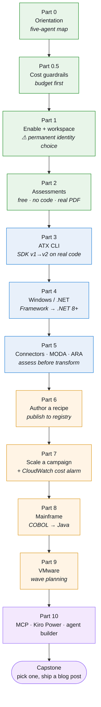

<sub>🟢 Beginner · 🔵 Intermediate · 🟠 Advanced · 🟣 Expert</sub>

> **A note on honesty for your blog:** AWS ships new AWS Transform capabilities constantly. Every factual claim here is sourced from AWS's own docs (see [Sources](#sources)), but *always re-check version-specific details against the live page* before you publish. Where I state a price or region list, I've linked the page it came from.

---

## Part 0 — Orientation: what AWS Transform actually is

### 🧠 Concept: the one-sentence definition

AWS Transform is a **collaborative enterprise modernization workbench powered by specialized AI agents**. You state a goal in natural language — "modernize this .NET app to run on Linux," "plan a migration for these 500 VMs," "upgrade this repo from AWS SDK v1 to v2" — and purpose-built agents do the heavy, repetitive analysis and transformation work while you review and approve.

It began as "Amazon Q Developer transformation capabilities" (previewed at re:Invent 2024), became generally available as **AWS Transform in May 2025**, and has since expanded across more workloads, regions, and interfaces.

By AWS's own first-year numbers, it processed **over 4.5 billion lines of code**, migrated tens of thousands of VMs, and saved roughly **1.69 million hours** of manual effort.

### 🧠 Concept: the five agents (your mental map)

This is the single most useful thing to memorize. Everything in AWS Transform organizes around **five use cases**, each with a specialized agent. The rest of this guide is a tour through them.

| Agent | What it does | Covered in |
|-------|--------------|------------|
| **Assessments** | Builds the business case: TCO, right-sizing, licensing, carbon, what-if scenarios | Part 2 |
| **Custom (code)** | Any-code-to-any-code: version upgrades, SDK migrations, language ports, tech-debt reports | Parts 3, 5, 6, 7 |
| **Windows** | .NET Framework → .NET 8+, SQL Server → open source, IIS → containers | Part 4 |
| **Mainframe** | COBOL/PL-I/JCL → Java/C#, VSAM/IMS/Db2 → cloud DBs, equivalence testing | Part 8 |
| **VMware** | Discovery, wave planning, landing zone, network conversion, cutover | Part 9 |

Each agent is reachable from **six interfaces**: web console, CLI, Kiro/VS Code, Visual Studio (VSIX), agent skills (Claude Code / Cursor / Codex), and MCP.

Drawn out, the service looks like this — one workbench, five agents, six ways in:

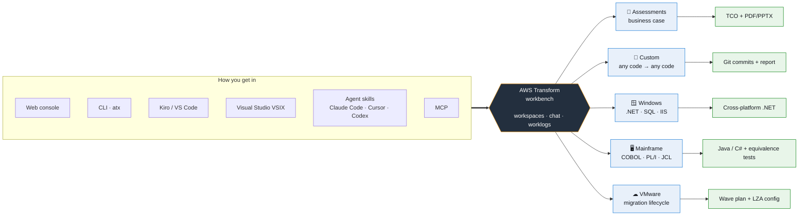

### 🧠 Concept: why "agentic" is the whole point

Traditional migration tooling hands you a report and leaves the work to you. An **agentic** service runs a loop:

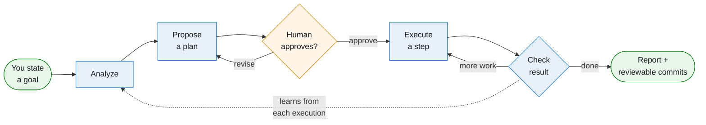

The two boxes worth staring at are **"Human approves?"** and **"Check result"**. The first is your control point — the place you catch a bad plan while it's still a proposal. The second is how the agent self-corrects, and it's why the `-c "mvn clean install"` flag in Part 3 matters so much: you're handing the agent a way to know whether it succeeded.

That loop is why AWS can claim 4x–80x speedups on tasks like network conversion and wave planning. The agent absorbs the thousands of tedious, mechanical edits; **you keep the judgment calls**. Internalize this division of labor now — it's the difference between using these tools well and being burned by them.

The other half of "agentic" is **continual learning**: the custom agent gets better each time it's applied to similar repositories. Your tenth repo goes faster than your first.

### 💡 Why it matters

Knowing the five-agent map means you'll never be lost in the console. Every project you create is "just" one of these five, and the workflow is identical across all of them: *describe goal → agent plans → you approve → agent executes → you review.*

### ✅ Checkpoint 0

Without looking back: name the five agents and one thing each does. Name the agentic loop's five stages. If you can, you're ready to touch the console.

---

## Part 0.5 — Money first: cost, free tier, and guardrails

> Do not skip this. You said these accounts are free for you to use — that makes it *more* important to understand which part of this service can actually generate a bill.

### 🧠 Concept: what's free and what's metered

Three distinct cost layers, and people conflate them constantly:

**1. The migration & modernization agents — no charge.** The VMware, Windows/.NET, mainframe, and assessments agents carry **no per-use cost** for the agent itself. ([AWS Transform pricing](https://aws.amazon.com/transform/pricing/))

**2. Custom code transformation & continuous modernization — metered.** Billed per **agent-minute** (the pricing page listed **$0.035 / agent-minute** as of 2026 — verify on the live page). A short SDK-upgrade run on a small repo is **cents**, not dollars. This is the one line item you can rack up by accident, which is why Part 7 has you alarm on it.

**3. The AWS resources involved — billed normally, and this is where real money lives.** The assessment is free; the EC2 instances it *recommends* are not. Discovery collectors, AWS MGN replication servers, landing zones, and target workloads all bill at standard rates.

> *Third-party coverage agrees on this shape — the agents are largely no-cost, custom/continuous is the metered piece, and downstream infrastructure is the real spend. (Summarized from [Qovery's 2026 cost analysis](https://www.qovery.com/blog/aws-transform-what-it-does-and-what-it-costs); content rephrased for licensing compliance.)*

The three layers, sized roughly by how much they can hurt you:

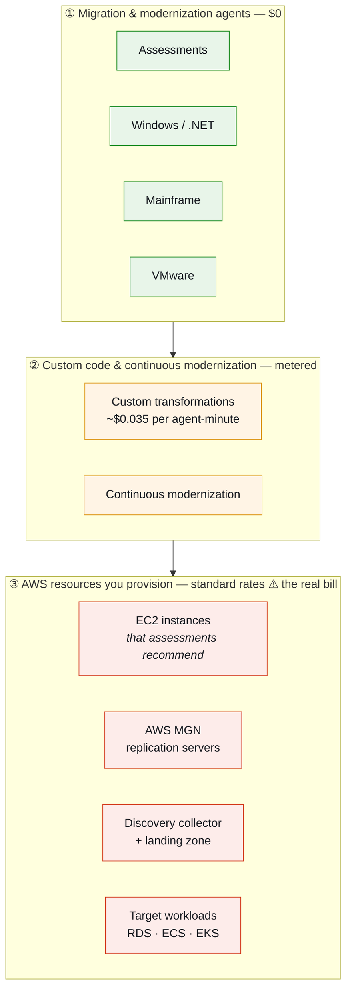

Read that bottom row again. **Every lab in this guide that can touch layer ③ is flagged with ⚠️ Cost caution**, and the teardown section exists specifically to drain it.

### 🛠 Lab 0.5 — Put the seatbelt on before driving

1. Sign in to the AWS Console with the account you'll experiment in.
2. **Billing and Cost Management → Budgets → Create budget**.
3. Create a **monthly cost budget** (start at **$10**) with an alert at **80%** to an email you actually read.
   - 📸 **Capture 01** → `images/screenshots/01-budget-created.png`
4. Add a second budget scoped to **EC2** specifically — that's your runaway-instance tripwire.
5. Open **Billing → Free Tier** and bookmark it. You'll check this page between sessions.

```bash
# Optional: confirm from the CLI which account you're about to experiment in
aws sts get-caller-identity
```

### ✅ Checkpoint 0.5

You can see a pending/active budget in the console and you have the Free Tier usage page bookmarked. You know which of the three cost layers each future lab touches.

### 💡 Why it matters

The expensive part of modernization is never the AI — it's forgetting to terminate a fleet of recommended EC2 instances after a demo. Every lab in this guide that can provision billable resources is flagged with a ⚠️ **Cost caution**. A budget alarm catches the one you miss.

---

## Part 1 — Enable the service and enter the workbench

### 🧠 Concept: profiles, identity, and the two URLs

Enabling AWS Transform creates a **profile** in a Region. The profile determines **how your users authenticate** — and this choice is **permanent**. You pick it once at setup and cannot swap identity models afterward. ([setup docs](https://docs.aws.amazon.com/transform/latest/userguide/transform-setup.html))

Your three options:

| Option | How users sign in | Good for | Gotcha |
|--------|-------------------|----------|--------|
| **IAM-only access** | Existing AWS/IAM credentials via AWS Sign-In | Solo learners, PoCs | No email notifications; an IAM identity and an SSO identity for the same human appear as **two separate users** whose work isn't linked |
| **IAM Identity Center (SSO)** | Dedicated web login, invitation email | Real teams — the production choice | Needs Identity Center enabled first |
| **Third-party IdP** | Okta Workforce Identity or Microsoft Entra ID | Enterprises with existing IdP | Requires app registration + client secret (stored in Secrets Manager) |

**Choose with this, because you only get one shot:**

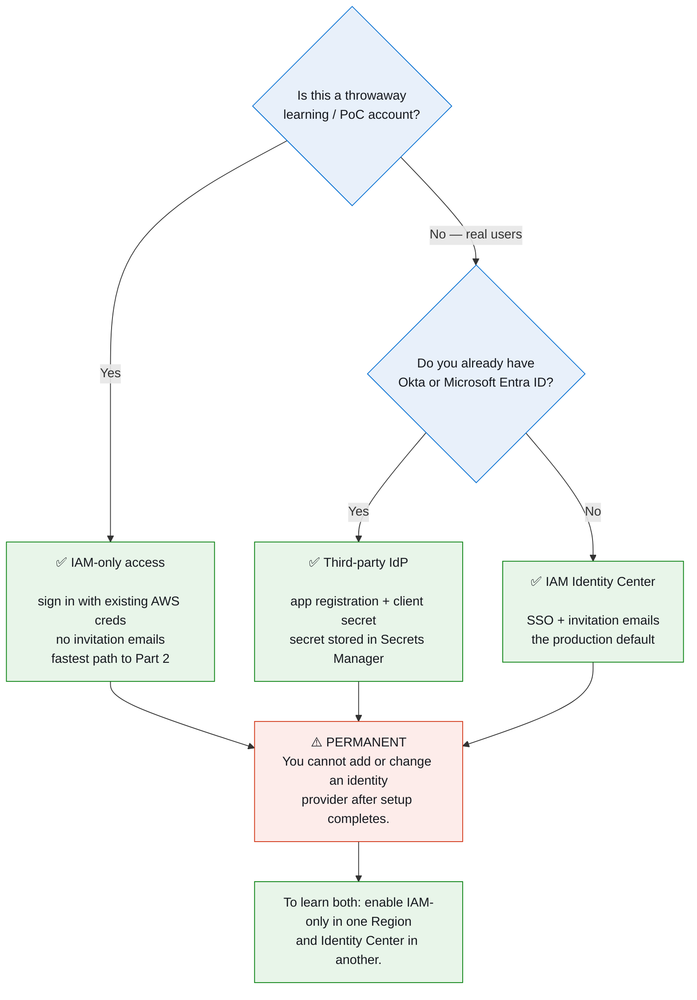

After enabling, the **Settings** tab surfaces two URLs you'll use constantly:

- **Web application URL** — the agentic UI you'll work in.
- **Start URL for IDE** — used to connect Kiro / VS Code.

Here is the shape of the enable page you're about to fill in:

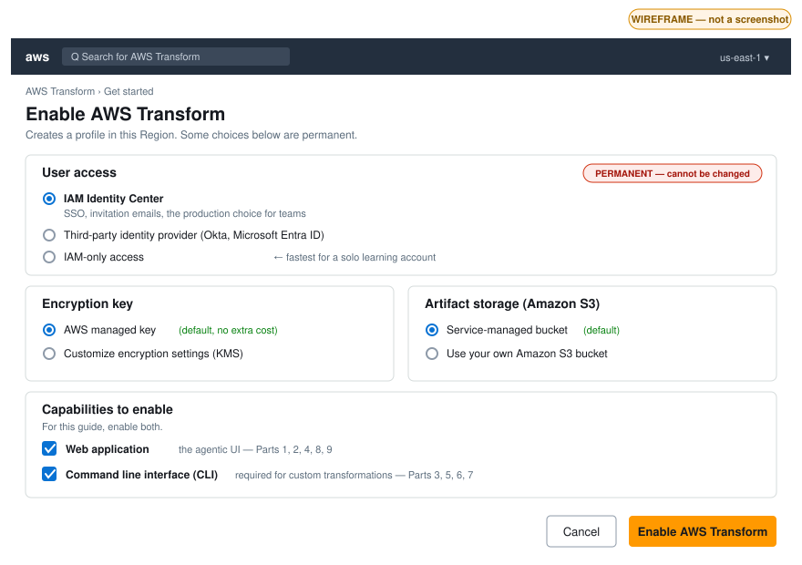

<sub>**Wireframe, not a screenshot.** Layout mock to orient you before you click — the live console will look different.</sub>

And the Settings tab afterward, which is where you collect the two URLs:

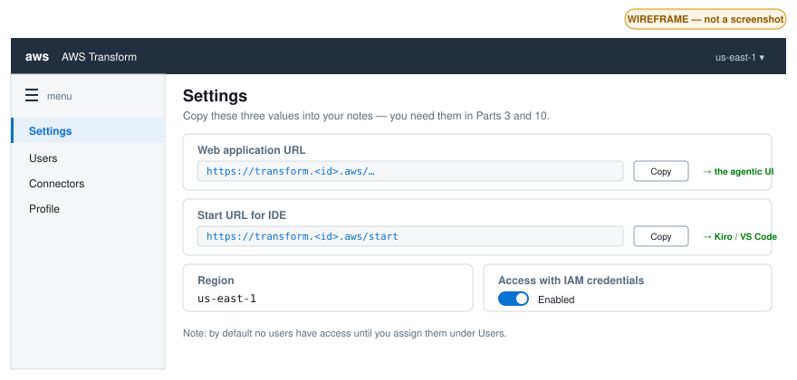

<sub>**Wireframe, not a screenshot.**</sub>

### 🧠 Concept: workspace roles are separate from authentication

A point that confuses people: *how you log in* and *what you can do* are two different systems. Once inside AWS Transform, **workspace roles** govern your permissions regardless of authentication method:

- **Admin** — full control of the workspace
- **Contributor** — does the work
- **Approver** — gates decisions at approval points
- **Read-only** — observes

For IAM-only profiles, the gate to get *in* is the `transform:AccessTransformProfile` permission on the profile resource; the gate on what you do *inside* is your workspace role.

### 🛠 Lab 1A — Enable AWS Transform

> **Region choice:** use **`us-east-1`** for learning — it has the broadest capability support. Custom code transformation is available in `us-east-1`, `eu-central-1`, `eu-west-2`, `ca-central-1`, `ap-northeast-1`, `ap-northeast-2`, `ap-southeast-2`, `ap-south-1`. ([region list](https://docs.aws.amazon.com/transform/latest/userguide/custom-get-started.html))
>
> Useful detail: **IAM Identity Center is not Region-limited for this purpose.** If you already have Identity Center set up in a Region AWS Transform doesn't support, you can still use it.

1. In the Console search bar, type **AWS Transform** and open it.
2. Choose **Get started** — this enables the service in your current Region.
   - 📸 **Capture 02** → `images/screenshots/02-get-started.png`
3. **Identity:** for a solo learning account pick **IAM-only access** (fastest, Lab 1B). To experience real onboarding, pick **IAM Identity Center** (Lab 1C). ⚠️ **This is the irreversible choice.**
4. **Encryption key:** leave the default **AWS managed key**. (You can choose *Customize encryption settings* → *Use an AWS KMS key* for a customer-managed key; note KMS keys carry a small monthly charge.)
5. **S3 bucket:** leave the default **service-managed bucket** — it stores transformation artifacts. (Bring-your-own-bucket is supported if you need artifacts in your own account.)
6. **Capabilities:** enable **both**:
   - **Web application** — the agentic UI.
   - **CLI** — required to create and run custom transformations.
7. Choose **Enable AWS Transform**. You'll see "Enabling AWS Transform…" while it provisions.

### 🛠 Lab 1B — Fast path: IAM-only access

1. Ensure the IAM user/role you'll use has `transform:AccessTransformProfile` on the profile.
2. Open the **Web application URL**; you'll be routed through AWS Sign-In.
3. You're in. Your in-app identity is your IAM principal.

Worth knowing for later: IAM API calls are logged in **CloudTrail** with the caller's identity, and actions IAM users take in a job are traceable in AWS Transform **worklogs**. That's your audit trail.

### 🛠 Lab 1C — Team path: IAM Identity Center (do this once, in a second Region, to learn it)

1. Console → **IAM Identity Center** → **Enable**. The default Identity Center directory is fine.
2. **Users → Add user**. Use a real email you control. Choose *send an email with password setup instructions*.
3. Back in AWS Transform: **Users → Assign users or groups** → find your user → **Done** → **Assign**.
4. Check that email for the **invitation** (link valid **7 days**). Click **Accept invitation** and set a password: **8+ chars, one uppercase, one lowercase, one number, one special character**.
5. Go to the **Web application URL**, sign in with the new username + password.

The full onboarding handshake, so you know who does what and where it can stall:

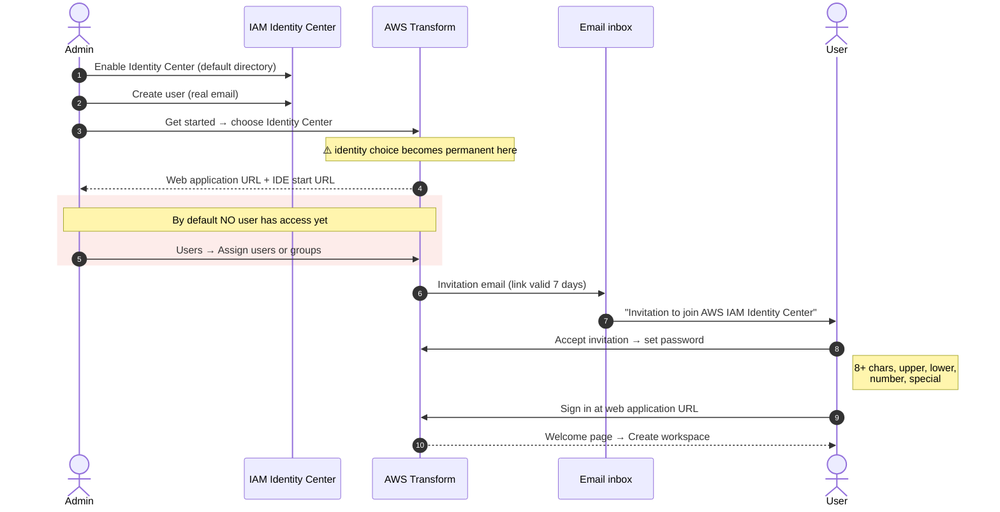

> Note: by default **no users have access** when you first enable it. Assignment is an explicit step — a common "why can't anyone log in?" moment, highlighted in red above.

### ✅ Checkpoint 1

- **Settings** tab shows a **Web application URL**, a **Start URL for IDE**, and your **Region**. Copy all three into a notes file — you'll need them in Parts 3 and 10.
- You land on the **Welcome page**, which lists capabilities like *Modernize IBM z/OS migrations*, *Migrate VMware workloads to Amazon EC2*, *Modernize .NET applications to Linux-ready cross-platform .NET*, and *Assess workloads for migration readiness*.
  - 📸 **Capture 03** → `images/screenshots/03-settings-urls.png` (the Settings tab — **redact your account/profile ID**)
  - 📸 **Capture 04** → `images/screenshots/04-welcome-page.png`

### 🛠 Lab 1D — Create your first workspace

1. On the Welcome page, choose **Create workspace**.
2. Name it `learning-transform`.
3. Open it.

This is your collaborative home base — jobs, natural-language chat, and worklogs all live here. In a real engagement, project managers, architects, developers, and security engineers all work in this same shared space in real time.

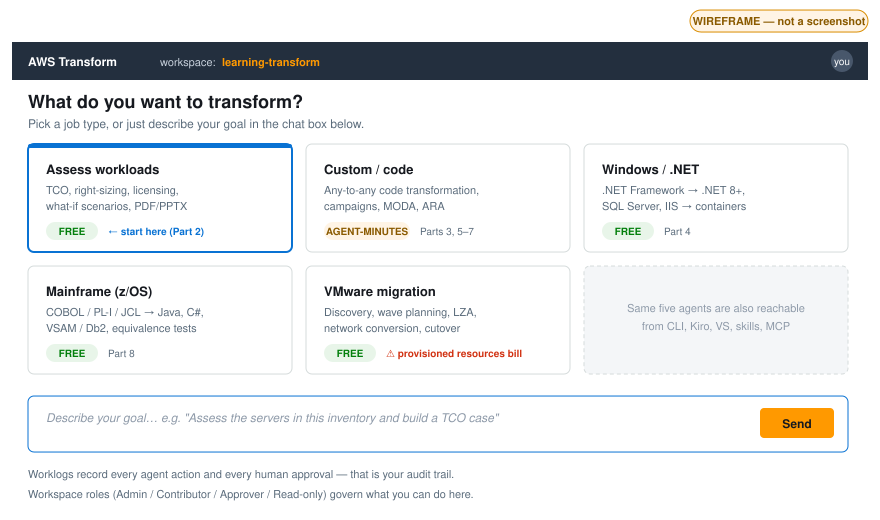

<sub>**Wireframe, not a screenshot.** The five cards map exactly to the five agents from Part 0 — this is the five-agent map made clickable.</sub>

- 📸 **Capture 05** → `images/screenshots/05-workspace-created.png`

#### How authentication and authorization combine

These are two separate systems, and conflating them is the most common access confusion:

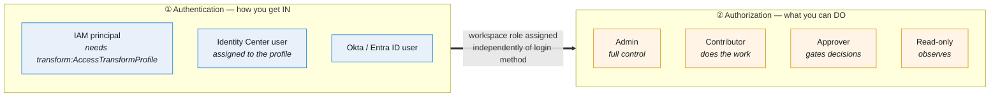

A consequence worth remembering: if the same human has **both** an IAM session and an Identity Center identity, AWS Transform sees **two separate users** and does not link their work.

### ✅ Checkpoint 1D

You have an empty workspace open with a chat/goal prompt. You're standing in the workbench.

### 💡 Why it matters

The permanence of the identity choice trips up real teams constantly — someone enables IAM-only for a quick PoC, the PoC becomes the production profile, and now they can't onboard the wider org through SSO without starting over. Doing both (IAM-only in one Region, Identity Center in another) as a deliberate exercise means you'll never be unsure about this in front of a customer.

---

## Part 2 — First real win: Assessments (free, no code)

> **Why start here:** Assessments is free, requires no source code, and teaches the core agent loop end to end (describe → analyze → refine via chat → generate deliverable). It's the gentlest possible path to a genuinely impressive artifact.

### 🧠 Concept: what an assessment produces

The Assessments agent turns a **server inventory** into a **data-driven business case**. It answers the question every migration starts with: *should we do this, and what will it cost?*

Capabilities you'll exercise:

- **Cost estimation** across EC2, RDS for SQL Server, EBS, S3, FSx, and end-user computing.
- **Automated right-sizing** — analyzes on-prem CPU/memory/performance and recommends appropriately sized EC2 instances.
- **SQL Server assessment** — specialized analysis for RDS vs EC2, including BYOL/License-Included options and Database Savings Plans.
- **Business value assessment** — staff productivity, resilience, business agility (beyond raw infra cost).
- **Sustainability** — estimated carbon footprint reduction.
- **Multi-scenario comparison** — build several scenarios (pricing models, Regions, instance families, licensing) and compare side by side.
- **Chat-based refinement** — adjust assumptions in natural language, even with limited data.
- **Deliverable generation** — executive presentations (**PPTX**) and detailed reports (**PDF**).

It accepts inventory from many sources: the **AWS Transform Discovery Tool**, **RVTools** exports (VMware), **CMDB** exports, **Migration Evaluator**, partner discovery tools, and MPA-format files.

End to end, that's inventory in, business case out:

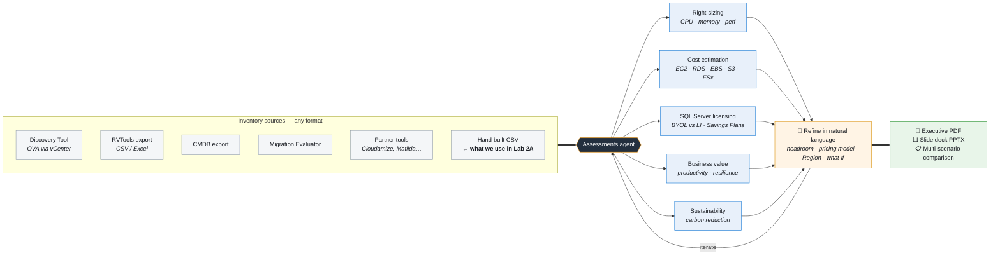

The **chat refinement loop** in the middle is the part people skip and shouldn't. A single-shot assessment gives you one answer; the loop is how you turn it into a defensible business case with stated assumptions.

### 🧠 Concept: right-sizing, in one breath

"Right-sizing" means mapping each on-prem server's *actual* CPU/memory/performance to the **cheapest EC2 instance that still fits**. On-prem over-provisioning is near-universal — teams buy for a 5-year peak and run at 20% utilization. Right-sizing is therefore where most TCO savings originate, not in some magic cloud discount. The agent does this per server, across multiple pricing models, in minutes.

### 🧠 Concept: Assessments vs Migration Evaluator

Worth knowing because interviewers and customers ask:

- **AWS Transform assessments** — *fast, self-service*. Built for x86 server migrations, uses your existing inventory data, gives targeted EC2 recommendations and quick TCO. Ideal when you want a rapid, focused answer.
- **AWS Migration Evaluator** — *comprehensive, expert-led*. Guided by AWS Solutions Architects, broader scope (detailed collection, storage assessment, sustainability, deep SQL Server analysis). Ideal when you need thorough planning with expert guidance.

### 🛠 Lab 2A — Build a sample inventory

You don't have a data center, so create a small realistic CSV. Save as `sample-inventory.csv`:

```csv
ServerName,OS,vCPU,MemoryGB,StorageGB,CPUUtilizationPct,PeakCPUPct,Environment,Application
web-01,Windows Server 2016,4,16,100,25,60,Production,StorefrontWeb
web-02,Windows Server 2016,4,16,100,22,58,Production,StorefrontWeb
app-01,Ubuntu 20.04,8,32,250,40,75,Production,StorefrontApp
app-02,Ubuntu 20.04,8,32,250,38,72,Production,StorefrontApp
db-01,Windows Server 2019 + SQL Server 2016,16,64,500,55,85,Production,StorefrontDB
batch-01,RHEL 8,8,16,200,15,90,NonProduction,NightlyBatch
report-01,Windows Server 2012 R2,4,32,300,30,65,Production,Reporting
file-01,Windows Server 2016,2,8,2000,10,25,Production,FileShare
```

Note what I deliberately included — these are the columns that make right-sizing meaningful:
- **Average *and* peak CPU** — lets the agent reason about headroom instead of guessing.
- **An `Application` column** — groups servers into real applications (this becomes essential in Part 9's wave planning).
- **A SQL Server box** — triggers the specialized licensing analysis.
- **A legacy Windows 2012 R2 box** — an end-of-support server, which is exactly the kind of finding that drives urgency.
- **A low-utilization fileserver** — the classic right-sizing win (2 vCPU at 10% doesn't need 2 vCPU).

### 🛠 Lab 2B — Run the assessment

1. In your workspace, start a new job and choose the **Assessment** job type (the console may word it "migration assessment" or "assess workloads").
2. **Upload `sample-inventory.csv`**. If asked about format, tell the agent in chat:
   > This is a simple CSV server inventory with OS, vCPU, memory, storage, average and peak CPU utilization, environment, and application grouping columns.
3. Let the agent analyze.
   - 📸 **Capture 06** → `images/screenshots/06-assessment-upload.png` (inventory accepted)
   - 📸 **Capture 07** → `images/screenshots/07-rightsizing-recommendations.png` (the per-server recommendation table — this is your money shot for the blog)

### 🛠 Lab 2C — Refine via chat (this is the real skill)

Chat refinement is the capability people under-use. Run each of these and watch the numbers move:

```text
Right-size assuming we need 25% headroom above observed peak CPU.
```
```text
Compare on-demand pricing against a 3-year Compute Savings Plan.
```
```text
Treat db-01 as a candidate for Amazon RDS for SQL Server. Show me
BYOL versus License-Included, and include Database Savings Plans options.
```
```text
Create a second scenario in eu-west-2 and compare it side by side with us-east-1.
```
```text
report-01 runs Windows Server 2012 R2, which is end of support.
Flag it as a priority and recommend a target OS.
```
```text
What's the estimated carbon footprint reduction from this migration?
```
```text
Add the business value assessment — staff productivity and resilience gains.
```

### 🛠 Lab 2D — Generate the deliverable

```text
Generate an executive summary as a PDF and a slide deck for the leadership team.
```

Download both. Open the PDF.

- 📸 **Capture 08** → `images/screenshots/08-scenario-comparison.png` (two scenarios side by side)
- 📸 **Capture 09** → `images/screenshots/09-executive-pdf.png` (a page of the generated PDF)

### ✅ Checkpoint 2

You have:
1. Right-sized EC2 recommendations per server, with rationale.
2. At least **two side-by-side scenarios** (different Region or pricing model).
3. SQL Server licensing options for `db-01`.
4. A downloadable **PDF** and **PPTX**.

That is a genuine migration business case, built in under an hour, for $0.

### 💡 Why it matters

This is the exact artifact that unlocks executive sign-off on a real migration — the thing that normally takes a consulting team weeks. You just learned the agent loop and produced a board-ready deliverable without writing a line of code or spending a cent on compute.

### ⚠️ Honest framing for your blog post

AWS is explicit, and you should be too: these are **directional estimates** that approximate cost based on current server configurations and assumed usage. They're guidance for planning, **not quotes**, and **not guarantees** of final cost. Actual costs vary with implementation choices, optimization, and real-world usage. For precise planning, customers should work with their AWS account team or a Partner.

Saying this plainly in your post is what separates a credible technical blog from marketing copy.

---

## Part 3 — Custom code modernization with the ATX CLI

> This is the deepest, most "practice at home" part of the whole service, and the one you'll use most as an engineer. The custom agent runs locally against a Git repo. A small run costs **cents** in agent-minutes.

### 🧠 Concept: AWS Transform custom (the `atx` CLI)

The **custom** agent transforms *any* code pattern — language to language, framework to framework, version to version — using two kinds of recipes:

**AWS-managed (built-in) transformations** — vetted, ready out of the box:

| Transformation | What it does |
|---|---|
| Java / Python / Node.js version upgrades | Including Lambda and non-Lambda variants |
| **AWS SDK v1 → v2** | The classic, highest-value mechanical migration |
| Java **x86 → Graviton** | Arm64 migration for cost/performance |
| **Log4J → SLF4J** | Logging facade migration |
| **Angular → React**, Angular version upgrades | Front-end framework modernization |
| **Spring Boot upgrades**, **JBoss → Spring Boot** | JVM framework modernization |
| Comprehensive code analysis | Tech-debt reporting |

**Custom transformations** — ones you define in natural language and publish for reuse (Part 6). These cover "any-to-any": language translations (Progress 4GL → Java, C → Rust, COBOL → Java) and architectural changes (x86 → Graviton, microservices decomposition).

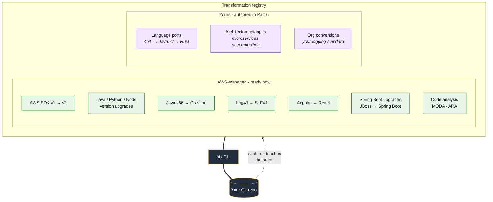

That dotted feedback arrow is **continual learning**, and it's a real operational consideration: your tenth repo in a campaign genuinely goes faster than your first, so don't benchmark the service on a single run.

Two properties make it enterprise-grade:
- **Continual learning** — the agent gets smarter when applied repeatedly to similar repositories.
- **Scale** — acts on one or many repositories, integrates with CI/CD, runs from a laptop, EC2, ECS/EKS containers, or any pipeline.

### 🧠 Concept: why it requires a Git repo

The agent performs transformations in **multiple steps and commits each intermediate step**. This has two consequences:

1. Your working directory **must be a valid Git repo** — otherwise execution fails.
2. You review the agent's work with **plain `git diff` / `git log`**.

This is the design decision that makes the whole thing trustworthy. There is no black box: every edit is a reviewable commit you can read, revert, or cherry-pick. **Your job is review; the agent's job is toil.**

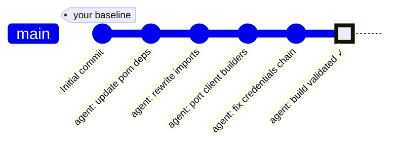

Which is why your review workflow is just Git:

```bash
git log --oneline              # every step the agent took
git diff <baseline-sha>        # the whole change, reviewable
git revert <one-bad-commit>    # surgical rollback, not all-or-nothing
```

Save that baseline SHA before you start. It's the difference between "the agent changed some things" and "here is precisely what changed."

### 🛠 Lab 3A — Install the AWS Transform CLI

**Prerequisites** ([docs](https://docs.aws.amazon.com/transform/latest/userguide/custom-get-started.html)):

| Requirement | Notes |
|---|---|
| **OS** | Linux (all distros), macOS, native Windows (Windows Terminal + PowerShell), or WSL |
| **Node.js 22 or later** | [nodejs.org/en/download](https://nodejs.org/en/download) |
| **Git** | Working directory must be a valid Git repo to execute |
| **AWS CLI v2** | Configured with credentials |

> ⚠️ **Windows caveat:** the `atx ct` (continuous modernization) commands are **not yet supported on native Windows**. Use **WSL** for those.

**Network endpoints** (allowlist these if you're behind a restrictive firewall):
```
transform-cli.awsstatic.com
transform-custom.<region>.api.aws
*.s3.amazonaws.com
```

**Steps:**

1. Verify your tooling:
   ```bash
   node --version    # expect v22.x or later
   git --version
   aws --version     # expect aws-cli/2.x
   ```

2. Install the CLI using the official installation script. **Copy the exact current command from the [Installing the AWS Transform CLI section of the docs](https://docs.aws.amazon.com/transform/latest/userguide/custom-get-started.html)** — AWS updates the script URL, and I'd rather you get it from the source than trust a possibly-stale snippet here.

   > 💡 **Easier alternative (genuinely recommended by AWS):** use **Kiro Power** or the AWS Transform **agent plugin**. During setup it checks prerequisites and installs/updates the CLI for you, then guides you through your first transformation. We do the manual path here so you understand the moving parts — Part 10 covers the guided path.

3. Verify:
   ```bash
   atx --version
   ```

#### ✅ Checkpoint 3A
`atx --version` prints a version string.

- 📸 **Capture 10** → `images/screenshots/10-atx-version.png` (bump your terminal font size first)

### 🛠 Lab 3B — Configure authentication and Region

**1. IAM permissions.** Attach a managed policy to your IAM user/role:

| Policy | Grants |
|---|---|
| `AWSTransformCustomFullAccess` | Everything, including creating the service-linked role for CloudWatch metrics |
| `AWSTransformCustomManageTransformations` | Create, update, read, delete transformation resources + execute |
| `AWSTransformCustomExecuteTransformations` | Execute only |

> 🔒 **Security note:** `FullAccess` is fine on a personal learning account. On any shared or production account, prefer the granular policies — give **execute-only** to people who just run recipes, and reserve manage permissions for recipe authors. Transformation definitions are **AWS resources with ARNs**, so you can scope IAM policies to specific transformations, and use **tags** for grouped access control.
>
> Also note: **IAM Identity Center is required for the web application, but *not* for the CLI** — the CLI only needs standard AWS credentials. This is why you can do Part 3 even on an IAM-only profile.

**2. Credentials.** Either:

```bash
aws configure    # writes ~/.aws/credentials
```

or environment variables:

```bash
export AWS_ACCESS_KEY_ID=...
export AWS_SECRET_ACCESS_KEY=...
export AWS_PROFILE=my-profile   # optional, selects a named profile
```

> On PowerShell, variables set with `$env:` apply to the **current session only**. Persist them via System Properties → Environment Variables, or `[System.Environment]::SetEnvironmentVariable()`.

**3. Region.** The CLI resolves Region in this precedence order:

1. `AWS_REGION` environment variable (highest)
2. `AWS_DEFAULT_REGION`
3. Selected profile in `~/.aws/config` (via `AWS_PROFILE`)
4. Default profile in `~/.aws/config`
5. Fallback to `us-east-1`

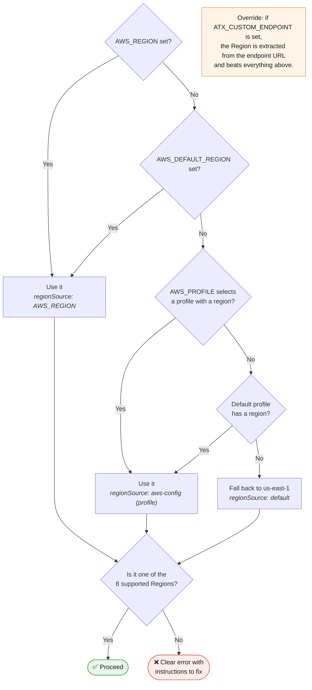

Set it explicitly to remove all doubt:

```bash
export AWS_REGION=us-east-1
# or permanently:
aws configure set region us-east-1
```

**4. Verify everything:**

```bash
aws sts get-caller-identity     # confirms credentials reach AWS
aws configure get region        # confirms region
```

Run the CLI with debug logging and you'll see the resolution spelled out, including a `regionSource` field telling you *where* the Region came from (e.g. `AWS_REGION`, `aws-config (profile: default)`, or `default`). If your Region is unsupported, the CLI fails with a clear message rather than silently misbehaving.

#### ✅ Checkpoint 3B
`get-caller-identity` returns your account and ARN; your Region is one of the eight supported ones.

### 🛠 Lab 3C — Your first AWS-managed transformation (AWS SDK v1 → v2)

We'll upgrade a Java project from AWS SDK for Java v1 to v2 — the canonical high-value built-in recipe.

1. Get a small Java project that imports `com.amazonaws.*` (SDK v1). Use one of your own or a tiny sample. Make it a clean Git repo:

   ```bash
   cd my-java-project
   git init
   git add .
   git commit -m "Initial commit"
   git rev-parse HEAD        # save this commit SHA — you'll diff against it
   ```

2. **Interactive mode** (best for learning — you converse with the agent):

   ```bash
   atx
   ```

   Then prompt it:
   > Execute the AWS/java-aws-sdk-v1-to-v2 transformation on the codebase at ./my-java-project

3. **Non-interactive mode** (scriptable, and runs a build to validate):

   ```bash
   atx custom def exec -n AWS/java-aws-sdk-v1-to-v2 -p ./my-java-project -c "mvn clean install" -x -t
   ```

   | Flag | Meaning |
   |---|---|
   | `-n` | transformation definition name |
   | `-p` | path to the codebase |
   | `-c` | build / validation command |
   | `-x` | execute |
   | `-t` | run with testing/validation |

   The `-c` flag is the important one conceptually: **you're giving the agent a way to check its own work.** It builds after transforming, and if the build fails it knows something's wrong.

Here's what actually happens when you press enter, including both exit paths:

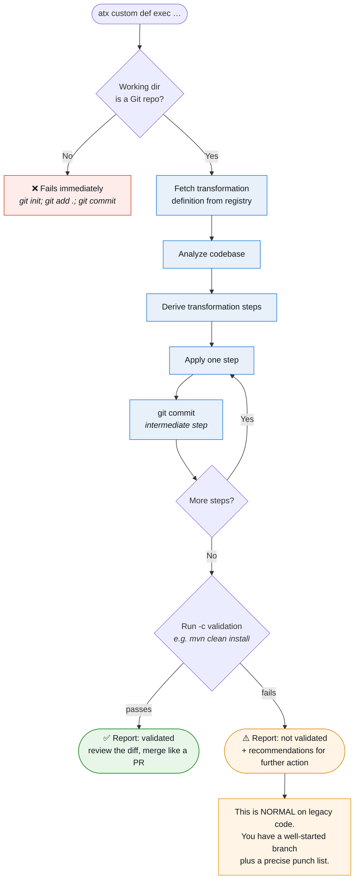

#### ✅ Checkpoint 3C
The run completes and prints a **report**. If validation (e.g. a successful Maven build) didn't pass, the report includes **recommendations for further action**. This is normal on real, messy code — a partial transformation plus a clear to-do list is still a massive head start.

### 🛠 Lab 3D — Review the work like a senior engineer

The agent committed its changes. Read them:

```bash
git log --oneline              # the step-by-step commits the agent made
git diff <original-commit-sha> # full diff from your starting point
git status                      # anything uncommitted
```

What to look for in an SDK v1→v2 diff:
- Imports moving from `com.amazonaws.*` → `software.amazon.awssdk.*`
- Client construction changing to the v2 builder pattern
- Credentials provider chain changes
- Request/response object renames
- `pom.xml` / `build.gradle` dependency swaps

Read it properly. **This review habit is the single most important skill in this entire guide.** An agent that does 95% of a migration correctly and 5% subtly wrong is dangerous to anyone who doesn't read diffs.

- 📸 **Capture 11** → `images/screenshots/11-sdk-migration-diff.png` — ⭐⭐ **the single most valuable image in your series.** Nearly every article about AI code transformation shows the marketing claim and never the diff. Showing it is what makes your post trustworthy.

### 🛠 Lab 3E — Explore the catalog

Run at least two more built-ins relevant to your stack. In interactive mode:

```text
List the AWS-managed transformations available.
```

Good second choices:
- **Log4J → SLF4J** on a Java project (small, very readable diff)
- A **Java version upgrade** (e.g. 8 → 17/21)
- **Angular version upgrade** on a front-end repo
- **Java x86 → Graviton** (interesting: it's as much config as code)

#### ✅ Checkpoint 3E
You've run **three** different built-in transformations and can explain, from the diffs, what each one changed and why.

### 🧠 Concept: understanding transformation results

When a transformation completes you get a report. Internalize this mental model:

- **Validated** (build/tests passed) → review the diff, then merge like any PR.
- **Not validated** → the report contains **recommendations for further action**. Treat it as a well-started branch with a punch list, not a failure.

Partial success is the normal, expected outcome on legacy code. The value isn't "zero human effort" — it's "90% of mechanical effort removed, with the remainder precisely identified."

### 💡 Why it matters

You've now done the thing enterprises pay consultancies seven figures for: a mechanical, error-prone, repo-wide migration completed in minutes and delivered as reviewable commits. Everything else in "custom" — including authoring your own recipes in Part 6 — is a variation on this exact loop.

---

## Part 4 — Windows / .NET modernization

### 🧠 Concept: full-stack Windows modernization

The Windows agent modernizes **up to 5x faster** across four layers simultaneously. The business driver is **escaping licensing costs** — customers report up to **70% reduction in operating costs** by moving off expensive licenses.

| Layer | Transformation |
|---|---|
| **Framework** | Legacy **.NET Framework → .NET 8+** (cross-platform), enabling containerization and Linux deployment |
| **Database** | **SQL Server → PostgreSQL / MySQL** or AWS-managed databases |
| **UI** | Legacy UI frameworks modernized (e.g. **Web Forms → Blazor or React**) |
| **Deployment** | Traditional **IIS → containerized microservices on ECS or EKS** |

Beyond the web console there's a dedicated **Visual Studio extension (VSIX)** for an integrated in-IDE .NET experience.

All four layers move together — that's what "full-stack" means here:

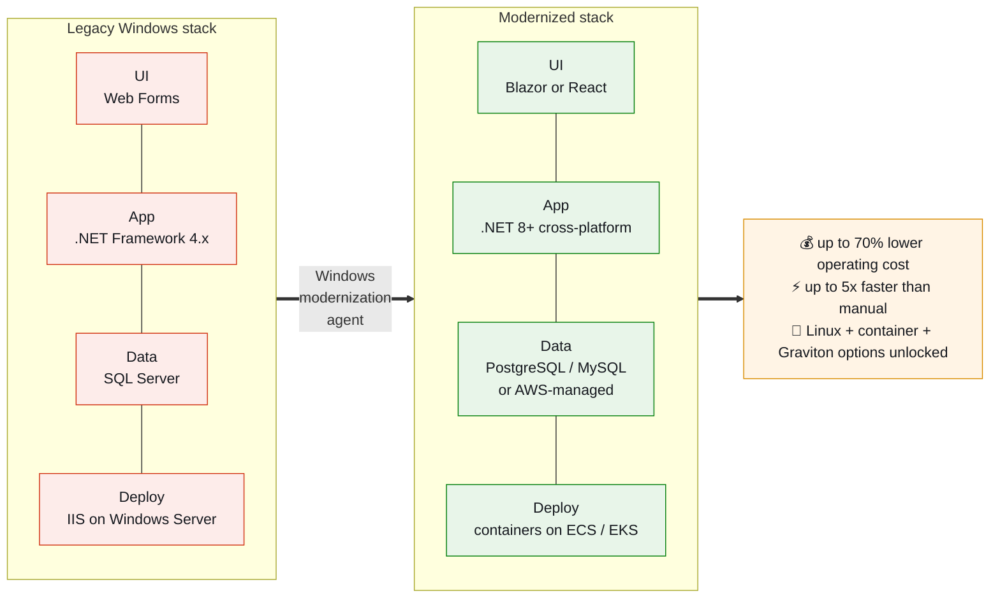

### 🧠 Concept: why ".NET Framework → .NET 8+" is the keystone

.NET Framework is Windows-only and chained to Windows Server licensing. Cross-platform .NET (8+) runs on Linux containers. Porting unlocks:

- Cheaper compute (Linux, and potentially Graviton/Arm64)
- Containerization → ECS/EKS → horizontal scale
- Modern tooling and performance improvements
- Escape from per-core Windows licensing

The port itself is **mechanical but sprawling**: NuGet package upgrades and replacements, API changes, deprecated and inefficient code components, `web.config` → modern configuration, and so on. Thousands of small, individually-easy, collectively-exhausting edits — precisely where agents shine.

### 🧠 Concept: the transformation plan, and why you read it before approving

For .NET the agent **analyzes the codebase, generates a transformation plan, and then executes tasks** against it. The plan is your control point. It typically covers:

- Upgrading and replacing NuGet packages and APIs
- Rewriting deprecated and inefficient code components
- Porting to cross-platform

**Always read the plan before approving.** This is where you catch "it's about to replace our custom authentication handler" while it's still a proposal instead of a commit.

### 🛠 Lab 4A — Prepare a .NET Framework app

1. Get or create a small **.NET Framework** app (something targeting `net48` or similar — a console app or a small ASP.NET Web Forms/MVC app is ideal).
2. Commit it to Git:
   ```bash
   cd my-dotnet-app
   git init && git add . && git commit -m "Initial commit"
   ```
3. Note the current target framework:
   ```bash
   grep -r "TargetFramework\|targetFramework" --include="*.csproj" --include="*.config" .
   ```

### 🛠 Lab 4B — Modernize via the web console

1. In your workspace, create a **Windows / .NET modernization** job.
2. Connect your repository (see Part 5A for connectors) or upload the code.
3. Let the agent **analyze** the codebase.
   - 📸 **Capture 12** → `images/screenshots/12-dotnet-analysis.png`
4. Review the generated **transformation plan**. Read every line.
   - 📸 **Capture 13** → `images/screenshots/13-transformation-plan.png` (**the most valuable screenshot in your whole series** — it shows the human control point)
5. **Approve** and let it execute.
6. Read the final report, including manual follow-ups.

### 🛠 Lab 4C — Modernize via Visual Studio (VSIX)

If you have Visual Studio, do this too — the experiences differ meaningfully:

1. Install the AWS Transform **Visual Studio extension (VSIX)**.
2. Open your .NET Framework solution.
3. Run the .NET modernization from inside VS, reviewing changes as IDE diffs.

Compare: the console is better for *planning and oversight*; the IDE is better for *human-in-the-loop refinement*.

### 🧠 Concept: web-to-IDE handoff

A recent and genuinely important capability: **start a modernization job in the web console, then hand it off to a developer IDE** (Kiro, VS Code, Visual Studio) for human-in-the-loop edits and refinement.

This encodes the realistic division of labor: the agent does the 90% that's mechanical, then hands you the 10% that needs judgment — in the environment where you're most effective at judgment.

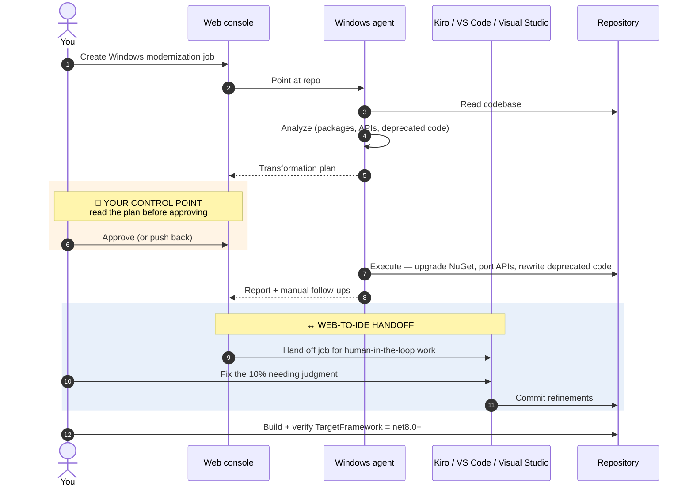

As you work through Lab 4B, deliberately notice **where the agent hands control back to you.** That boundary — the two highlighted bands above — is the most interesting thing in the product.

### ✅ Checkpoint 4

- Your app's `.csproj` shows a `TargetFramework` of **net8.0 or later**.
- It builds.
- You can describe three specific categories of change from the diff (packages, APIs, config).
- You read the transformation plan *before* approving, and can name one thing you'd have pushed back on.

### 💡 Why it matters

.NET modernization is one of the most common and most expensive enterprise projects in existence (IDEMIA: 4x faster, 30% cost reduction; Thomson Reuters: 4x faster). Doing even a toy port end to end teaches you the plan→approve→execute→refine rhythm and the web↔IDE handoff that define real engagements.

---

## Part 5 — Connectors, MODA, and ARA

> Three capabilities that belong together: how you *connect* to real code, how you *assess* its debt, and how you assess its *readiness for the agentic era*.

### 🛠 Lab 5A — Connect a source-code repository

Real jobs read from your repos. AWS Transform connects to **GitHub, GitLab, and Bitbucket**.

1. In your workspace, open **Connectors** (via the menu icon in the top-left of the console, which also exposes **Users** and **Settings**).
2. Add a connector to your Git provider and authorize it for a test repository.
3. Create a job that targets the connected repo instead of an upload.

**Background you should have:** to use connectors and continuous modernization effectively, AWS expects basic Git proficiency, familiarity with your source platform (GitHub/GitLab/Bitbucket), working knowledge of **IAM permissions**, and comfort with command-line tools. If any of those are shaky, shore them up — they're the substrate everything else sits on.

#### ✅ Checkpoint 5A
A job can list and read files from your connected repo.

### 🧠 Concept + 🛠 Lab 5B — Modernization Analysis (MODA)

**MODA** scans code for **cloud-native maturity gaps** and maps findings to **AWS modernization pathways**. It completes in **5–30 minutes per repository**.

The key framing: MODA doesn't just say "this code is old." It says "this code is old *in these specific ways*, and here are the AWS pathways that address each." It turns vague technical debt into a prioritized, actionable backlog.

Run it:

```bash
atx
```
> Run a modernization analysis (MODA) on ./my-project and summarize the top gaps.

Then interrogate the result:
```text
Which of these gaps block containerization?
Rank these findings by effort-to-value ratio.
```

#### ✅ Checkpoint 5B
You have a report ranking issues (hardcoded configuration, non-containerized deployment, outdated frameworks, state held locally, etc.) with suggested AWS pathways, and you've asked at least two follow-up questions in chat.

- 📸 **Capture 14** → `images/screenshots/14-moda-report.png`

### 🧠 Concept + 🛠 Lab 5C — Agentic Readiness Analysis (ARA)

This is the forward-looking one, and the most interesting thing in the service for a 2026 blog post.

**ARA evaluates whether your systems are ready to be safely called by AI agents**, across five dimensions:

| Dimension | The question it answers |
|---|---|
| **APIs** | Are capabilities exposed as clean, discoverable, well-described interfaces an agent can use? |
| **Identity** | Can an agent authenticate as itself, with scoped permissions — rather than borrowing a human's credentials? |
| **State management** | Is state explicit and recoverable, or hidden in session affinity an agent will break? |
| **Human-in-the-loop controls** | Are there approval gates on consequential actions? |
| **Observability** | If an agent does something wrong, can you tell what happened and why? |

Run it on a service repo:

```bash
atx
```
> Run an Agentic Readiness Analysis on ./my-service and score each dimension.

Then the money question:
```text
What would make this service safe for an autonomous agent to call?
```

#### ✅ Checkpoint 5C
You can name all five ARA dimensions from memory and state one concrete fix ARA recommended for your repo.

- 📸 **Capture 15** → `images/screenshots/15-ara-scores.png` — ⭐ ARA is barely covered anywhere. A clear screenshot of real scores is genuinely novel content.

### 💡 Why it matters

MODA tells you *what debt you have*. ARA tells you *whether you're ready for what's coming*. Together they form the "assess before you transform" layer that keeps large campaigns from going sideways.

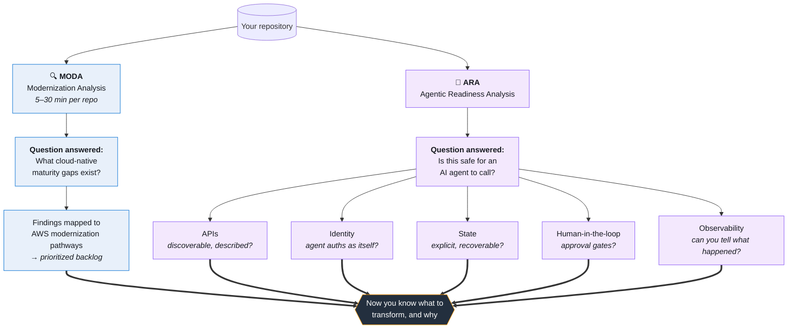

ARA deserves special attention in your blog: as more software becomes agent-callable, **"is my service agent-ready?" becomes a standard audit** — the way "is my service 12-factor?" became one a decade ago. Writing about it now is writing early.

### 🧠 Concept: the modernization → AI flywheel

This is the strategic story AWS tells, and it's worth understanding because it's why this service exists at all:

```
Agentic AI reduces modernization cost and time
        ↓
Modernized workloads become the foundation for AI applications
        ↓
Those AI capabilities enable more modernization
        ↓
            (repeat)
```

AWS frames this as a self-reinforcing cycle — AI enables modernization, and modernization enables more AI. ARA is the clearest expression of it: you modernize so agents can work with your systems, using agents to do the modernizing.

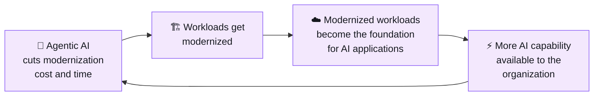

---

## Part 6 — Author and publish your own transformation

> Here you stop being a *consumer* of recipes and become an *author*. This is the skill that separates "I used AWS Transform" from "I operationalized AWS Transform for my organization."

### 🧠 Concept: anatomy of a custom transformation

When built-in recipes don't fit, you create your own. The workflow:

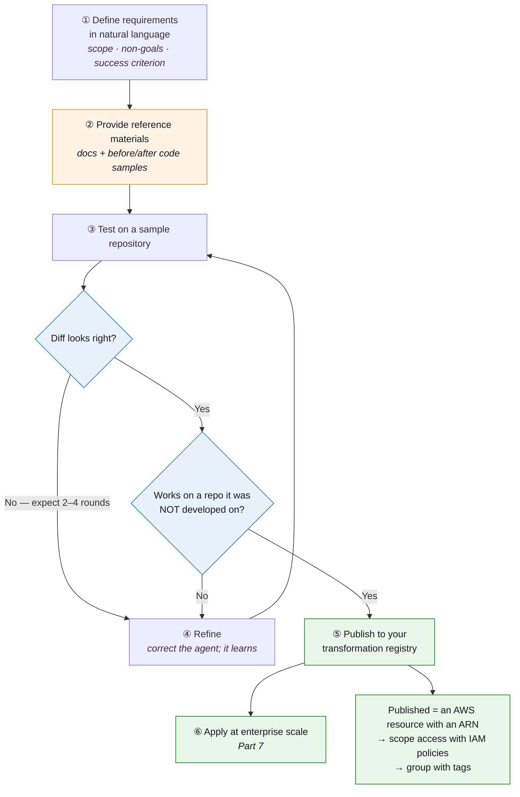

Two boxes do the heavy lifting. **② reference materials** is the quality lever (explained below). **"Works on a repo it was NOT developed on"** is the honest generalization test from Lab 6C — skip it and you'll publish a recipe that only works on the codebase you tuned it against.

Two properties make published transformations real infrastructure rather than scripts:

- **They're AWS resources with ARNs.** You can scope IAM policies to specific transformations, and use **tags for grouped access control**. "Only the platform team can run the database-migration recipe" is an IAM policy, not a convention.
- **The agent learns from each execution**, becoming smarter when applied repeatedly to similar repositories.

Supported scope is genuinely "any-to-any": language translations (**Progress 4GL → Java**, **C → Rust**, **COBOL → Java**) through architectural changes (**x86 → Graviton**, **microservices decomposition**).

### 🧠 Concept: reference materials are the quality lever

If you take one thing from this part: **the single biggest determinant of transformation quality is the reference material you provide.**

A prompt like "migrate from Mocha to Jest" gives the agent only its training knowledge. The same prompt plus (a) the Jest migration guide URL, (b) a before/after example from your own codebase, and (c) your team's testing conventions gives it a specification. The difference in output quality is not subtle.

Think of it as the difference between telling a new contractor "modernize the kitchen" and handing them blueprints.

### 🛠 Lab 6A — Pick a good first target

Choose something **small and precisely defined**. Good candidates:

| Target | Why it's a good first recipe |
|---|---|
| Replace `console.log` with a structured logger (`pino`) across a Node repo | Mechanical, verifiable, clearly bounded |
| Migrate a test suite from **Mocha → Jest** | Well-documented target, obvious pass/fail signal |
| **Upgrade a .NET Lambda runtime** | AWS published a worked example of exactly this — see their [.NET Lambda runtime upgrade walkthrough](https://aws.amazon.com/blogs/dotnet/aws-transform-custom-automating-net-lambda-runtime-upgrades/) |
| Enforce a logging/telemetry standard across services | Realistic platform-team use case |

Bad first recipes: anything vague ("make this better"), anything spanning many unrelated concerns, or anything where you can't tell mechanically whether it worked.

### 🛠 Lab 6B — Author it

1. Start interactive mode:
   ```bash
   atx
   ```

2. Tell the agent you want to **create a new transformation**, and describe the requirement precisely. Structure your description:

   ```text
   I want to create a transformation that migrates a Node.js project's test
   suite from Mocha+Chai to Jest.

   Scope:
   - Convert test files under test/ and **/*.spec.js
   - Replace Mocha's describe/it with Jest equivalents (mostly compatible)
   - Convert Chai assertions (expect(x).to.equal(y)) to Jest (expect(x).toBe(y))
   - Replace Mocha/Chai devDependencies with jest in package.json
   - Update the npm test script
   - Add a jest.config.js with sensible defaults

   Do NOT touch:
   - Any production source code under src/
   - CI configuration files
   - The existing coverage thresholds

   Success criteria: `npm test` passes with the same number of tests
   passing as before the migration.
   ```

   Notice the structure: **scope, explicit non-goals, and a machine-checkable success criterion.** Write all three every time.

3. **Provide reference materials.** Paste the Jest migration guide, a before/after example from your own code, and your team's conventions.

4. **Test** on a sample repo. Inspect the diff with `git diff`.

5. **Refine.** Correct the agent where it went wrong — it learns within the session and across runs. Expect 2–4 iterations for a good recipe. This is normal; don't judge the first attempt.

6. **Publish** to your organization's transformation registry once it's reliable.

### 🛠 Lab 6C — The real test: generalization

Run your published transformation against a repo it was **not** developed on.

This is the honest test of a recipe. Anything can be tuned until it works on one codebase. A recipe worth publishing handles the second and third codebase too. Note where it struggles — that's your next refinement cycle.

### ✅ Checkpoint 6

- You have a **published** transformation definition with an ARN.
- You ran it successfully on a repo it wasn't originally built against.
- You can state its scope, non-goals, and success criterion in one breath.

### 💡 Why it matters

A good custom recipe converts a week of per-developer toil into a one-line command the whole team can run — and because it's an ARN-addressable AWS resource with IAM controls, it's governable. This is the mechanism by which modernization becomes a *platform capability* rather than a *project*.

---

## Part 7 — Scale a transformation campaign

### 🧠 Concept: from one repo to hundreds

The custom agent is CLI-first precisely so it can act on **one or many repositories** and integrate with **CI/CD platforms for continuous modernization**. It runs from a laptop, EC2, ECS/EKS containers, or any pipeline.

For oversight at that scale, the **web application provides campaign management**: a web experience for managing large-scale transformation campaigns and tracking progress across multiple repositories.

The division of responsibility:
- **CLI** = execution engine (scriptable, parallelizable, pipeline-friendly)
- **Web app** = command and control (dashboards, aggregate metrics, chat-based status)

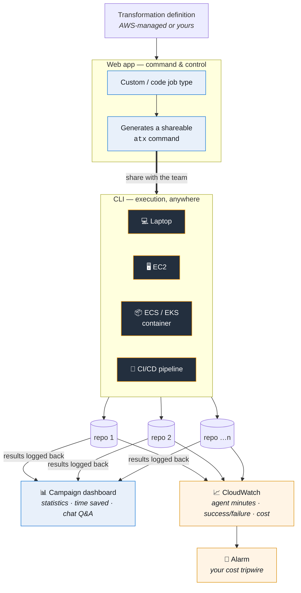

The shareable-command mechanism is the clever bit: developers run transformations wherever they work, and results aggregate centrally **without anyone building reporting plumbing**.

### 🛠 Lab 7A — Non-interactive runs, the way a pipeline does it

Re-run a built-in transformation with zero interaction:

```bash
atx custom def exec -n AWS/java-aws-sdk-v1-to-v2 -p ./repo -c "mvn clean install" -x -t
```

Now wrap it in a minimal campaign runner:

```bash
#!/usr/bin/env bash
# campaign.sh — run one transformation across many repos
set -uo pipefail

TRANSFORM="AWS/java-aws-sdk-v1-to-v2"
BUILD_CMD="mvn clean install"
REPOS=(
  "$HOME/code/service-a"
  "$HOME/code/service-b"
  "$HOME/code/service-c"
)
LOG_DIR="./campaign-logs"
mkdir -p "$LOG_DIR"

for repo in "${REPOS[@]}"; do
  name=$(basename "$repo")
  echo "=== $name ==="

  # Safety: only operate on a clean git tree
  if [[ -n "$(git -C "$repo" status --porcelain)" ]]; then
    echo "SKIP $name: working tree not clean"
    continue
  fi

  # Record the starting point so the diff is reviewable later
  git -C "$repo" rev-parse HEAD > "$LOG_DIR/$name.base-sha"

  if atx custom def exec -n "$TRANSFORM" -p "$repo" -c "$BUILD_CMD" -x -t \
       > "$LOG_DIR/$name.log" 2>&1; then
    echo "OK   $name"
  else
    echo "FAIL $name (see $LOG_DIR/$name.log)"
  fi
done

echo
echo "Review each repo with:"
echo '  git -C <repo> diff $(cat campaign-logs/<name>.base-sha)'
```

```bash
chmod +x campaign.sh && ./campaign.sh
```

Note the two safety behaviors I built in, because they matter at scale: **refuse to run on a dirty working tree**, and **record the base SHA** so every transformation remains reviewable afterward. A campaign that you can't review is a campaign you can't ship.

### 🛠 Lab 7B — Campaign management in the web app

1. In the web application, choose the **Custom / code** job type.
2. Tell the agent the name of the **transformation definition** you want to use.
3. The web app returns an **`atx` command you can share with your team**. This command invokes the transformation *and logs execution results back to the web application*.
4. Run that command against a few repos.
5. Open the **Dashboard**: view statistics and **time-savings measurements**, and **ask questions in chat** about the progress of your job.
   - 📸 **Capture 16** → `images/screenshots/16-campaign-dashboard.png`

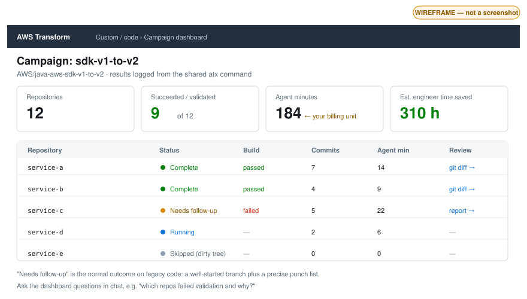

<sub>**Wireframe, not a screenshot.** Note the realistic status mix — `Complete`, `Needs follow-up`, `Running`, `Skipped (dirty tree)`. A campaign dashboard that shows all green is a campaign you aren't looking at closely enough.</sub>

#### ✅ Checkpoint 7B
Two or more repos appear in a single dashboard with aggregated metrics and a time-savings figure.

### 🧠 Concept + 🛠 Lab 7C — Observability with CloudWatch

AWS Transform emits **CloudWatch metrics** for **cost**, **success/failure rates**, and **agent minutes**. Agent minutes is your billing unit for custom transformations, so this closes the loop with Part 0.5.

1. Open **CloudWatch → Metrics** and find the AWS Transform namespace.
2. Chart **agent minutes** and **success/failure rate** for your runs.
   - 📸 **Capture 17** → `images/screenshots/17-cloudwatch-agent-minutes.png`
3. Create an **alarm** on agent minutes:

```bash
# Adjust namespace/metric names to match what you see in the console
aws cloudwatch put-metric-alarm \
  --alarm-name aws-transform-agent-minutes-guard \
  --alarm-description "Alert if AWS Transform agent minutes spike" \
  --namespace "AWS/Transform" \
  --metric-name "AgentMinutes" \
  --statistic Sum \
  --period 3600 \
  --evaluation-periods 1 \
  --threshold 120 \
  --comparison-operator GreaterThanThreshold \
  --treat-missing-data notBreaching
```

> Verify the exact namespace and metric name in the console before relying on this — then add `--alarm-actions <your-sns-topic-arn>` to actually get notified.

Also note the service-linked role: `AWSTransformCustomFullAccess` includes permission to create the service-linked role required for **CloudWatch metrics emission to your account**. If you used a more granular policy and see no metrics, that's your first thing to check.

#### ✅ Checkpoint 7C
You have a CloudWatch alarm that would fire if a runaway job burned through agent minutes, and you can see success/failure rates for your past runs.

### ✅ Checkpoint 7 (overall)
You can run a transformation across multiple repos unattended, see the results aggregated in one dashboard, and you'd be alerted if cost ran away.

### 💡 Why it matters

Scale *is* the value proposition — "transform hundreds of applications in parallel." Running one repo teaches mechanics. Wiring up campaign tracking plus cost metrics teaches you to run it **responsibly**, which is the actual job. Any engineer can run `atx` once; the person who can run it across 200 repos with observability and cost control is the one who gets to lead the program.

---

## Part 8 — Mainframe modernization

> You almost certainly don't have a mainframe at home, so this part is concept-heavy with a sample-driven lab. It's also non-optional for the "expert" claim — mainframe is the flagship, highest-value use case.

### 🧠 Concept: the four phases

The mainframe agent compresses modernization **from years to months** across the full lifecycle:

| Phase | What happens |
|---|---|
| **1. Codebase analysis** | Analyzes **COBOL, PL/I, JCL** and other mainframe languages; maps dependencies, **detects missing artifacts**, assesses complexity with **visual dependency representations** |
| **2. Automated refactoring** | Converts mainframe code to **Java or C#** while **preserving business logic**; works with **Claude Code and other agentic IDEs** for the forward-engineering phase |
| **3. Data migration** | Migrates **VSAM, IMS DB, Db2** to cloud-native databases |
| **4. Testing and validation** | **Automated equivalence testing** to ensure functional parity between legacy and modernized applications |

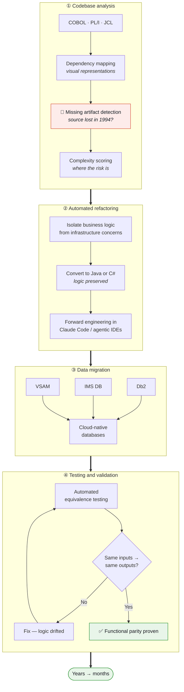

The two red-flag boxes — **missing artifact detection** in phase ① and the **equivalence loop** in phase ④ — are where mainframe projects actually live or die. Everything between them is comparatively mechanical.

### 🧠 Concept: why "detects missing artifacts" is a headline feature

This sounds mundane and is actually the single most common reason mainframe projects fail before they start.

A 40-year-old mainframe application typically has source for *most* of itself. Some modules exist only as compiled load modules whose source was lost in 1994. Some copybooks are referenced but absent. Some JCL calls a utility nobody can identify. **You cannot plan a migration you can't fully inventory**, and discovering a missing artifact in month nine is catastrophic.

Automated detection surfaces these gaps in the *analysis* phase, when they're a planning input rather than a crisis.

### 🧠 Concept: why equivalence testing is the hard part

With mainframes, business logic is frequently **undocumented and decades old**. The people who wrote it have retired. The requirements document, if it ever existed, doesn't describe what the code actually does — including the bugs that downstream systems now depend on.

So you can't just rewrite it against a spec. You must **prove the new system produces identical outputs for identical inputs**. That's what automated equivalence testing does, and it's why "preserving business logic" is stated as a non-negotiable constraint rather than a nice-to-have.

This is also why the phases are ordered the way they are: analyze (know what you have) → refactor (preserve logic) → migrate data → **prove equivalence**.

### 🛠 Lab 8 — Learn by sample

1. Find a small public COBOL sample (there are many on GitHub — a simple batch program with a copybook and some JCL is ideal). Commit it to a repo.
2. In the web console, create a **mainframe modernization** job and point it at the COBOL.
3. Walk through the **analysis** output carefully:
   - The **dependency map** — which programs call which, which copybooks are used where
     - 📸 **Capture 18** → `images/screenshots/18-mainframe-dependency-map.png` (visually striking — great blog image)
   - **Missing artifacts** it detected
   - **Complexity scoring** — where the risk concentrates
4. Let it propose a **refactoring plan** to Java or C#. Read the plan and specifically notice **how it isolates business logic** from infrastructure concerns (file I/O, screen handling, job control).
5. Ask the agent questions:
   ```text
   Which modules carry the highest conversion risk, and why?
   What would equivalence testing need to cover for this program?
   What data stores does this application touch, and what are the AWS targets?
   ```
6. Read AWS's prescriptive pattern [Modernize and deploy mainframe applications using AWS Transform and Terraform](https://docs.aws.amazon.com/prescriptive-guidance/latest/patterns/modernize-mainframe-app-transform-terraform.html) to see how the output plugs into a real IaC deployment pipeline.

### ✅ Checkpoint 8

You can walk a colleague through the four phases (analyze → refactor → migrate data → equivalence test), explain why each exists, and explain why missing-artifact detection and equivalence testing are the two phases where projects actually die.

### 💡 Why it matters

Mainframe is where the money and the credibility are. Public results: **Bridgestone** completed modernization in **7 months with 90% efficiency gains**; **Toyota** accelerated mainframe modernization with generative AI. Even without hardware access, understanding this lifecycle fluently makes you credible in the single most lucrative modernization conversation in enterprise IT.

---

## Part 9 — VMware migration planning

### 🧠 Concept: the five stages

The VMware agent automates the entire migration lifecycle — "migrations that once took years now complete in months." It supports **VMware, bare metal, Hyper-V, and database workloads**.

| Stage | What the agent does |
|---|---|
| **1. Discovery** | Via the **Discovery Collector** (an OVA deployed through vCenter), **RVTools** CSV/Excel exports, CMDB, or third-party tools (Cloudamize, Matilda Cloud, etc.) |
| **2. Wave planning** | Analyzes application dependencies, business priorities, and technical constraints to group workloads into **optimized migration waves** — weeks of manual effort → minutes |
| **3. Landing zone** | Generates **Landing Zone Accelerator (LZA)** configurations for secure multi-account environments; also supports **CloudFormation, CDK, and Terraform** |
| **4. Network conversion** | Converts on-prem network configs into AWS equivalents (**VPCs, subnets, transit gateways**) — up to **80x faster** than manual |
| **5. Rehost or replatform** | Full rehosting lifecycle (agent deployment, test instances, cutover orchestration) **or** replatform to containers on **ECS/EKS** — in the same workflow |

It also supports **first-party AWS agents, third-party partner agents, and custom Bring Your Own Agent workflows**.

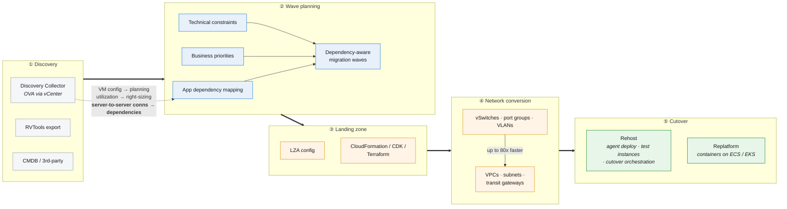

Notice the dotted arrow: **server-to-server connection data is what makes wave planning possible at all.** Without it you're guessing at dependencies, and the whole downstream plan inherits that guess.

### 🧠 Concept: what the Discovery Collector actually collects

Deployed as an OVA through vCenter, it gathers three distinct things, and understanding *why each one* clarifies the whole pipeline:

1. **VM configuration** → feeds business case generation and migration planning
2. **Resource utilization** → feeds right-sizing recommendations
3. **Database metadata and server-to-server connections** → feeds **application dependency mapping**, which is what makes wave plans possible

That third item is the crown jewel. Without server-to-server connection data you're guessing at dependencies, and guessing at dependencies means guessing at waves.

**RVTools** exports are the common alternative — CSV or Excel exports with detailed VMware environment information including **vSwitches, port groups, and VLANs** (which is what drives network conversion).

### 🧠 Concept: waves, and why dependency-awareness is the whole game

You cannot move 500 servers at once. A **wave** is a batch you cut over together.

Get waves wrong and you end up with a half-migrated application — web tier in AWS, database still on-prem — talking across a high-latency link, with a rollback plan nobody tested. That's the classic migration failure mode, and it's a *planning* failure, not a technical one.

Dependency-aware wave planning means tightly-coupled components move together. The agent reasons over dependencies, business priorities, and technical constraints to produce groupings that minimize downtime and risk.

### 🧠 Concept: rehost vs replatform

Know these cold — they come up in every migration conversation:

- **Rehost** ("lift and shift") — move the VM as-is to EC2. Fast, low risk, no modernization benefit. The agent manages the full lifecycle: agent deployment, test instances, cutover orchestration.
- **Replatform** — change the runtime while migrating, e.g. to containers on **ECS or EKS**. More benefit, more effort.

The notable thing is you can do **either or both within the same workflow**. Real portfolios are mixed: rehost the 300 boring servers, replatform the 20 that matter.

```mermaid
flowchart TD
    VM["A workload in your<br/>migration portfolio"] --> Q1{"Does modernizing it<br/>change the business case?"}

    Q1 -->|"No — it just needs to run"| RH["🚚 <b>Rehost</b> (lift &amp; shift)<br/><br/>VM → EC2 as-is<br/>agent deploy → test instance → cutover<br/><br/>✅ fast, low risk<br/>❌ no modernization benefit"]

    Q1 -->|"Yes — worth the effort"| Q2{"Container-ready, or<br/>can be made so?"}
    Q2 -->|"Yes"| RP["📦 <b>Replatform</b><br/><br/>→ containers on ECS / EKS<br/><br/>✅ real modernization gain<br/>❌ more effort and testing"]
    Q2 -->|"Not yet"| RH2["Rehost now,<br/>modernize later<br/><i>a legitimate strategy</i>"]

    RH & RP & RH2 --> MIX["Same workflow handles both.<br/>Real portfolios are mixed:<br/>rehost the 300 boring servers,<br/>replatform the 20 that matter."]

    classDef rh fill:#e8f0fa,stroke:#0972d3,color:#16191f
    classDef rp fill:#e8f5e9,stroke:#037f0c,color:#16191f
    classDef mix fill:#fff4e5,stroke:#d98c00,color:#16191f
    class RH,RH2 rh
    class RP rp
    class MIX mix
```

### 🛠 Lab 9 — Simulate a wave plan

Without a vCenter, use RVTools-style data to exercise the planner. Build on your Part 2 inventory, now with explicit dependencies. Save as `vmware-inventory.csv`:

```csv
VMName,OS,vCPU,MemoryGB,StorageGB,AvgCPUPct,Application,Tier,DependsOn,VLAN,BusinessCriticality
web-01,Windows Server 2016,4,16,100,25,Storefront,web,app-01;app-02,110,High
web-02,Windows Server 2016,4,16,100,22,Storefront,web,app-01;app-02,110,High
app-01,Ubuntu 20.04,8,32,250,40,Storefront,app,db-01,120,High
app-02,Ubuntu 20.04,8,32,250,38,Storefront,app,db-01,120,High
db-01,Windows Server 2019 + SQL Server,16,64,500,55,Storefront,data,,130,Critical
report-01,Windows Server 2012 R2,4,32,300,30,Reporting,app,db-01;dw-01,120,Medium
dw-01,RHEL 8,16,128,4000,45,Reporting,data,,130,Medium
batch-01,RHEL 8,8,16,200,15,NightlyBatch,app,db-01,120,Low
file-01,Windows Server 2016,2,8,2000,10,FileShare,data,,140,Low
dc-01,Windows Server 2019,2,8,100,12,Infrastructure,identity,,100,Critical
```

I built in the patterns a planner should catch. Here's the dependency graph hiding in that CSV:

```mermaid
flowchart BT
    subgraph APP1["Application: Storefront"]
        direction BT
        DB1[("db-01<br/>SQL Server<br/><b>Critical</b>")]
        A1["app-01"] --> DB1
        A2["app-02"] --> DB1
        W1["web-01"] --> A1
        W1 --> A2
        W2["web-02"] --> A1
        W2 --> A2
    end

    subgraph APP2["Application: Reporting"]
        direction BT
        DW1[("dw-01<br/>data warehouse")]
        RP1["report-01<br/><i>⚠ Win 2012 R2 — EOS</i>"] --> DW1
    end

    subgraph APP3["Application: NightlyBatch"]
        BA1["batch-01<br/><i>Low criticality</i>"]
    end

    subgraph INFRA["Infrastructure"]
        DC1[["dc-01<br/>domain controller<br/><b>Critical</b>"]]
        FS1["file-01<br/>file share"]
    end

    RP1 -.->|"🔺 CROSS-APP<br/>DEPENDENCY"| DB1
    BA1 --> DB1

    APP1 -.->|"implicit"| DC1
    APP2 -.->|"implicit"| DC1

    classDef crit fill:#fdecea,stroke:#d13212,color:#16191f
    classDef eos fill:#fff4e5,stroke:#d98c00,color:#16191f
    classDef low fill:#f4f6f8,stroke:#8d99a8,color:#16191f
    class DB1,DC1 crit
    class RP1 eos
    class BA1,FS1 low
```

The traps, and what a good planner does with each:

| Pattern | What a good wave plan does |
|---|---|
| **Storefront** is a clean 3-tier app | All five VMs land in the **same wave** |
| **Reporting → Storefront's `db-01`** | A **cross-application dependency** — the thing that breaks naive plans. Either both apps move together, or you accept a temporary cross-link with eyes open |
| **`dc-01`** domain controller | Infrastructure almost everything implicitly needs → **early foundational wave** |
| **`batch-01`** low criticality, depends on a critical DB | Ideal **low-risk pilot wave** candidate |
| **`report-01`** on Windows 2012 R2 | End-of-support → **priority flag**, and an OS upgrade decision rather than a straight rehost |

Judge the agent's output against this table. That's the exercise.

**Steps:**

1. In the web console, create a **VMware migration** job.
2. Upload the inventory and tell the agent it's RVTools-style data with a `DependsOn` dependency column.
3. Let it propose **migration waves**.
   - 📸 **Capture 19** → `images/screenshots/19-wave-plan.png`
   - 📸 **Capture 20** → `images/screenshots/20-dependency-graph.png` (if it renders a visual dependency map — compare it to my Mermaid graph above)

   Then evaluate it critically:
   ```text
   Explain why each wave is grouped the way it is.
   Did you keep all Storefront tiers in a single wave?
   How did you handle the cross-application dependency between
   Reporting and the Storefront database?
   Which wave should dc-01 be in, and why?
   Propose a low-risk pilot wave for the first cutover.
   ```
4. Ask it to **generate a landing zone** configuration. Try **Terraform** format and review the output.
5. Ask about **network conversion** for the VLANs in the inventory, and read how it maps VLANs/port groups to VPC constructs (subnets, route tables, transit gateway attachments).

> ⚠️ **Cost caution:** this lab is **planning only** — generating plans, landing-zone configs, and network designs is free. **Do not** actually deploy the landing zone or start AWS MGN replication on a learning account unless you intend to pay for and promptly tear down those resources. Replication servers bill continuously while active.

> 📌 **LZA gotcha worth knowing:** if you use the Landing Zone Accelerator together with AWS Transform migration capabilities, your **AWS Transform account and LZA installation must be in the same AWS Organization**. Separate Organization IDs are **not supported** and cause inconsistencies in organizational management and resource deployment.

### ✅ Checkpoint 9

- You have a generated wave plan where each sample application's tiers are grouped together.
- You can explain how the agent handled the cross-application dependency.
- You have a landing-zone config artifact you can read.
- You can define *wave*, *rehost*, *replatform*, and *LZA* without notes.

### 💡 Why it matters

Wave planning and network conversion are AWS's headline speedup claims, and they're backed publicly: **CSL** migrated 5,000 servers across 29 data centers with **10x faster planning** and 30% operational cost savings; **Vector** completed a VMware migration **34% faster** than traditional methods.

Even a simulated run teaches you the vocabulary — waves, LZA, rehost vs replatform, dependency mapping — that dominates every real migration program conversation.

---

## Part 10 — Expert: IDEs, MCP, Kiro Power, and the agent builder

> The frontier. This is where AWS Transform stops being "a console you visit" and becomes "capabilities you invoke from inside your own tooling."

### 🧠 Concept: the six interfaces, and when to use each

The same agents are reachable six ways. Experts choose deliberately:

| Interface | Best for |
|---|---|
| **Web console** | Planning, cross-team collaboration, campaign dashboards, approvals |
| **CLI (`atx`)** | Automation, CI/CD, batch across many repos |
| **Kiro Power / VS Code** | Developer-centric, in-editor modernization with diff review |
| **Visual Studio (VSIX)** | .NET modernization without leaving the IDE |
| **Agent skills** | Plugins for **Claude Code, Cursor, Codex** |
| **MCP** | Invoking transformation from any orchestrator or custom toolchain |

```mermaid
flowchart TD
    Q{"What are you<br/>doing right now?"}

    Q -->|"Planning with<br/>other people"| W["🌐 Web console<br/><i>workspaces · approvals · dashboards</i>"]
    Q -->|"Automating across<br/>many repos"| C["⌨️ CLI · atx<br/><i>CI/CD · batch</i>"]
    Q -->|"Writing code<br/>right now"| I{"Which editor?"}
    I -->|"Kiro / VS Code"| K["🧩 Kiro Power<br/><i>guided setup, installs the CLI for you</i>"]
    I -->|"Visual Studio"| V["🪟 VSIX<br/><i>.NET modernization in-IDE</i>"]
    I -->|"Claude Code ·<br/>Cursor · Codex"| S["🔌 Agent skills"]
    Q -->|"Building your own<br/>tooling or agent"| M["🔗 MCP<br/><i>+ agent builder toolkit</i>"]

    classDef web fill:#e8f0fa,stroke:#0972d3,color:#16191f
    classDef cli fill:#232F3E,stroke:#FF9900,color:#ffffff
    classDef ide fill:#e8f5e9,stroke:#037f0c,color:#16191f
    classDef adv fill:#f3e8fd,stroke:#8b5cf6,color:#16191f
    class W web
    class C cli
    class K,V,S ide
    class M adv
```

### 🧠 Concept: MCP in one breath

**MCP (Model Context Protocol)** is a standard protocol that lets an AI orchestrator call external tools. AWS Transform exposing MCP integration means you can **trigger transformations from inside another agent's reasoning loop** — invoking transformation capabilities directly from orchestrators, IDEs, and coding environments.

Why this is a bigger deal than it sounds: it makes modernization **composable**. Your own agent can decide, mid-task, that a repo needs an SDK upgrade, call AWS Transform to do it, and continue. That's the beginning of multi-agent modernization pipelines where AWS Transform is a *capability* rather than a *destination*.

```mermaid
flowchart LR
    subgraph BEFORE["Without MCP"]
        direction TB
        H1["You"] --> H2["Open AWS Transform"]
        H2 --> H3["Run transformation"]
        H3 --> H4["Go back to your work"]
    end

    subgraph AFTER["With MCP — composable"]
        direction TB
        O1["Your orchestrator<br/>/ custom agent"]
        O1 --> O2{"Reasoning:<br/>this repo needs<br/>an SDK upgrade"}
        O2 -->|"tool call"| O3["AWS Transform<br/>via MCP"]
        O3 -->|"result"| O2
        O2 --> O4["…continues its own task"]
    end

    BEFORE ==>|"AWS Transform becomes a<br/><b>capability</b>, not a <b>destination</b>"| AFTER

    classDef old fill:#f4f6f8,stroke:#8d99a8,color:#16191f
    classDef new fill:#f3e8fd,stroke:#8b5cf6,color:#16191f
    class H1,H2,H3,H4 old
    class O1,O2,O3,O4 new
```

### 🛠 Lab 10A — Kiro Power (the guided path)

Since you're reading this inside **Kiro**, this is the natural home — and it's what AWS explicitly recommends for guided setup.

1. In Kiro, open the **Powers** panel and look for the **AWS Transform** power.
2. Activate it and authenticate with your AWS credentials. During setup it **checks prerequisites and installs or updates the AWS Transform CLI when needed**, then guides you through your first transformation.
3. Run one of your earlier transformations (e.g. SDK v1→v2) **from inside the editor**, reviewing diffs in Kiro's UI.
4. Explore the **pre-built playbooks and individual tasks** the Power exposes.

> You still need appropriate AWS permissions and access to the repository you want to transform — the Power handles tooling, not authorization.

#### ✅ Checkpoint 10A
You ran a transformation without leaving the IDE and reviewed the changes as editor diffs.

- 📸 **Capture 21** → `images/screenshots/21-kiro-power-diff.png`

### 🛠 Lab 10B — Agent skills in another assistant

If you use **Claude Code, Cursor, or Codex**, install the AWS Transform agent skill/plugin and invoke a built-in transformation from a natural-language prompt there.

Then do the comparison that actually teaches you something — run the *same* transformation three ways (raw CLI, Kiro Power, agent skill) and note:
- Where each surfaces the transformation plan
- How each presents diffs
- Which gives you the best approval/review experience
- Which you'd put in front of a junior engineer

That comparison is excellent blog material; nobody writes it because it takes doing all three.

### 🛠 Lab 10C — MCP integration

1. Point an MCP-capable client at the AWS Transform MCP integration.
2. Trigger a transformation **as a tool call** from within an orchestrated workflow.
3. Read AWS's write-up: [Building and running custom code transformations without leaving your editor](https://aws.amazon.com/blogs/devops/building-and-running-custom-code-transformations-without-leaving-your-editor/).

#### ✅ Checkpoint 10C
An agent other than AWS Transform's own successfully invoked a transformation on your behalf.

### 🧠 Concept + 🛠 Lab 10D — The agent builder toolkit

The genuine frontier capability: **extend AWS Transform with your own custom agents** using **Kiro Power combined with the AWS Transform base agent and SDK**.

1. Clone the official samples:
   ```bash
   git clone https://github.com/aws-samples/aws-transform-custom-samples
   cd aws-transform-custom-samples
   ```
2. Read the READMEs. Two standouts:
   - **`agentic-atx-platform/`** — an AI-powered code transformation platform built on **Amazon Bedrock AgentCore + AWS Transform CLI**, transforming codebases at scale through natural language via a web UI or CLI.
   - **`scaled-execution-containers/`** — containerized execution deployment with least-privilege IAM.
3. Run a sample end to end.
4. Then the expert exercise: **sketch your own agent.** What organization-specific knowledge would you encode? (Your internal framework conventions? Your compliance requirements? Your deployment patterns?) That's the gap between a generic transformation and one that knows your shop.

#### ✅ Checkpoint 10D
You can describe how a custom agent plugs into the AWS Transform base agent, you've run at least one sample from the toolkit, and you've sketched an agent specific to your own environment.

### 🧠 Concept: the regional and capability roadmap

Keep an eye on these — the service moves fast, and knowing what's new is part of being the expert in the room:

- **MCP integration** — invoke from orchestrators, IDEs, coding environments
- **Kiro Power and agent skills** — playbooks for Kiro, Claude Code, Cursor, Codex
- **Web-to-IDE handoff** — start in console, finish in IDE
- **Agent builder toolkit** — custom agents on the AWS Transform base agent + SDK
- **Expanded Regions** — Mumbai, Tokyo, Seoul, Sydney, Canada, Europe
- **CloudWatch metrics** — cost, success/failure rates, agent minutes

Bookmark [AWS Transform – Latest Innovations](https://aws.amazon.com/transform/) and check it before you publish anything.

### 💡 Why it matters

Experts don't click consoles; they embed capabilities into their own tooling. Mastering MCP and the agent builder is how you roll AWS Transform out as **infrastructure for an engineering organization** rather than an app individuals happen to use. It's also the most under-documented area, which makes it the most valuable thing you can blog about.

---

## Capstone — prove you're an expert

Pick **one** and execute it end to end, documenting every step for your blog. Each maps to a different career narrative.

### Option 1 — The full .NET journey *(best for a developer audience)*

```
.NET Framework app
  → MODA analysis (what debt exists?)
  → ARA analysis (is it agent-ready?)
  → modernize to .NET 8+
  → containerize
  → (optionally) deploy to ECS
  → before/after writeup with CloudWatch metrics
```

**Deliverable:** a post showing real diffs, the transformation plan, what the agent got wrong, and what you had to fix by hand. That last part is what makes it trustworthy.

### Option 2 — Author and scale a recipe *(best for a platform-engineering audience)*

```
Identify a repeated mechanical change in your codebases
  → author a custom transformation
  → iterate until it generalizes
  → publish to the registry with IAM scoping
  → run across 3+ repos via campaign.sh
  → present the campaign dashboard with time-savings
```

**Deliverable:** a post with the actual transformation definition, the iteration history (what failed and why), and measured time savings.

### Option 3 — The migration business case *(best for an architect/consulting audience)*

```
Build a realistic 50-server inventory
  → full assessment with 3 what-if scenarios
  → dependency-aware wave plan
  → landing-zone config (Terraform)
  → network conversion design
  → executive PDF + PPTX
```

**Deliverable:** a post walking through the business case as if pitching a real migration, with the honest caveats about directional estimates.

### ✅ Expert checkpoint — answer these without notes

1. Which agents are free versus metered, and what's the metered unit?
2. Why must the custom agent's working directory be a Git repo, and why is that a *feature*?
3. What's the difference between MODA and ARA, and what are ARA's five dimensions?
4. Why is the identity choice at setup permanent, and what are the three options?
5. What's a migration "wave," and what specifically goes wrong without dependency-awareness?
6. Name three built-in transformations and one concrete thing each changes.
7. In mainframe modernization, why are missing-artifact detection and equivalence testing the two phases where projects die?
8. What are the three AWS managed IAM policies for custom transformations, and who should get each?
9. What's the difference between rehost and replatform, and can you do both in one workflow?
10. How does MCP integration change what you can build on top of AWS Transform?

If you can answer all ten **and** you've completed a capstone, you've genuinely gone beginner → expert.

---

## Teardown — leave your account clean

> Do this after every session. Keeping accounts and checkouts pristine is a professional habit, and here it's also a cost control.

1. **Stop/terminate any launched compute** from assessment or VMware labs — EC2 instances, RDS instances, AWS MGN replication servers. **This is the only thing that bills meaningfully.**
   ```bash
   aws ec2 describe-instances \
     --filters "Name=instance-state-name,Values=running" \
     --query 'Reservations[].Instances[].[InstanceId,InstanceType,Tags[?Key==`Name`].Value|[0]]' \
     --output table
   ```
2. **Delete test workspaces and jobs** you no longer need.
3. **Remove Git connectors** if you're done with them (they hold authorization to your repos).
4. **Check CloudWatch agent-minute usage** and the **Billing dashboard** against your Part 0.5 budget.
5. If you're completely finished with the service, you can **delete the AWS Transform profile** — note this also deletes stored user information. ⚠️ Remember the identity choice can't be changed, so only delete if you intend to start over.
6. **Locally:** check your sample repos with `git status`, and keep generated artifacts out of any tracked tree you care about.
   ```bash
   # keep campaign logs and scratch output untracked
   printf 'campaign-logs/\n*.base-sha\n' >> .gitignore
   ```

### ✅ Teardown checkpoint
No running compute from these labs, billing flat, local repos clean.

- 📸 **Capture 22** → `images/screenshots/22-teardown-clean.png` (zero running instances, or a flat billing graph). Ending your series with proof you cleaned up is a small thing that readers notice and trust.

---

## Quick reference

### The agent → use-case map
**Assessments** (business case) · **Custom** (any-code-to-any-code) · **Windows** (full-stack .NET/SQL/IIS) · **Mainframe** (COBOL→Java/C#) · **VMware** (migration lifecycle)

### Key commands

```bash
# Setup verification
node --version && git --version && aws --version
atx --version
aws sts get-caller-identity
aws configure get region

# Interactive agent (chat mode)
atx

# Run a built-in transformation, non-interactively, with validation
atx custom def exec -n AWS/java-aws-sdk-v1-to-v2 \
    -p ./my-project -c "mvn clean install" -x -t

# Review what the agent did
git log --oneline
git diff <original-commit-sha>
git status

# Region override
export AWS_REGION=us-east-1
```

### Built-in transformations to know
Java / Python / Node.js version upgrades (Lambda + non-Lambda) · **AWS SDK v1 → v2** · Java **x86 → Graviton** · **Log4J → SLF4J** · **Angular → React** / Angular upgrades · **Spring Boot upgrades** · **JBoss → Spring Boot** · comprehensive code analysis & tech-debt reporting

### Supported Regions (custom code transformation)
`us-east-1` · `eu-central-1` · `eu-west-2` · `ca-central-1` · `ap-northeast-1` · `ap-northeast-2` · `ap-southeast-2` · `ap-south-1`

### IAM managed policies
| Policy | Who gets it |
|---|---|
| `AWSTransformCustomFullAccess` | Learning accounts; platform admins |
| `AWSTransformCustomManageTransformations` | Recipe authors (create/update/read/delete + execute) |
| `AWSTransformCustomExecuteTransformations` | Developers who only run existing recipes |

### Workspace roles
**Admin** · **Contributor** · **Approver** · **Read-only** — applied regardless of how the user authenticated.

### Prerequisites checklist
- [ ] Node.js 22+
- [ ] Git (working dir must be a valid repo)
- [ ] AWS CLI v2, configured
- [ ] Supported Region set
- [ ] IAM policy attached
- [ ] Budget alarm configured
- [ ] Network endpoints allowlisted (`transform-cli.awsstatic.com`, `transform-custom.<region>.api.aws`, `*.s3.amazonaws.com`)

### Analysis types
| Acronym | Full name | Answers |
|---|---|---|
| **MODA** | Modernization Analysis | What cloud-native maturity gaps exist? (5–30 min/repo) |
| **ARA** | Agentic Readiness Analysis | Is this system safe for AI agents to call? |

---

## Blogging notes

If you publish this as a series, a structure that works:

| Post | Content | Hook |
|---|---|---|
| 1 | Parts 0–2 | "I built a migration business case in an hour for $0" |
| 2 | Part 3 | "I let an AI agent rewrite my Java SDK calls and read every commit" |
| 3 | Parts 4–5 | ".NET Framework to .NET 8, plus the ARA audit nobody's talking about" |
| 4 | Parts 6–7 | "Authoring a custom transformation and running it across 10 repos" |
| 5 | Parts 8–9 | "Mainframe and VMware: the two lifecycles that decide migration outcomes" |
| 6 | Part 10 + capstone | "Embedding AWS Transform in your own tooling with MCP" |

Three things that will make your series better than most coverage:

1. **Show the diffs.** Almost everyone writes about these tools without showing a single line of generated code. Screenshots of real `git diff` output are instantly credible.
2. **Document what failed.** Where did the agent get it wrong? What did you fix by hand? A post that only shows success reads like marketing; a post that shows the 10% you had to fix reads like engineering.
3. **Keep the cost framing honest.** The agents are largely free, custom transformation is metered per agent-minute, and the real bill is downstream infrastructure. Readers will trust everything else you say if you get this right.

---

## Appendix A — Screenshot capture plan

The wireframes in this guide orient you; **these captures are the real thing**, and they're what will make your blog series credible. Take them as you work — going back later to re-stage a screenshot is miserable.

### Setup

```bash
mkdir -p images/screenshots
```

### ⚠️ Redact before publishing

Every capture below may expose something you don't want on the public internet. Check for:

- **AWS account ID** (12 digits) — in ARNs, the console header, profile IDs
- **Profile / web application URL** — contains a tenant identifier
- **Email addresses** in user lists and invitations
- **IAM user and role names** that reveal internal naming
- **Real hostnames, IPs, and VLAN IDs** if you ever swap my sample inventory for real data
- **Repository URLs** for private repos

A quick way to blur regions on Linux before publishing:

```bash
# requires ImageMagick
convert in.png -region 320x28+640+40 -blur 0x12 out.png
```

### The capture list

| # | Filename | Part | What to capture | Blog value |
|---|---|---|---|---|
| 01 | `01-budget-created.png` | 0.5 | Budget created with alert threshold | Shows you're responsible with cost |
| 02 | `02-get-started.png` | 1A | The enable/Get started page, **before** you submit | Compare against my wireframe |
| 03 | `03-settings-urls.png` | 1 | Settings tab with both URLs — **redact the profile ID** | Proves setup completed |
| 04 | `04-welcome-page.png` | 1C | Welcome page listing the capabilities | Nice visual for post 1 |
| 05 | `05-workspace-created.png` | 1D | Empty workspace with the job-type cards | The five-agent map, made real |
| 06 | `06-assessment-upload.png` | 2B | Inventory accepted by the agent | Shows "any format" working |
| 07 | `07-rightsizing-recommendations.png` | 2B | Per-server EC2 recommendation table | ⭐ **money shot for post 1** |
| 08 | `08-scenario-comparison.png` | 2D | Two scenarios side by side | Demonstrates what-if analysis |
| 09 | `09-executive-pdf.png` | 2D | A page of the generated PDF | ⭐ The tangible deliverable |
| 10 | `10-atx-version.png` | 3A | Terminal: `atx --version` | Proof of a working install |
| 11 | `11-sdk-migration-diff.png` | 3D | Terminal: `git diff` of the SDK v1→v2 change | ⭐⭐ **The single most valuable image in your series.** Almost nobody publishes this |
| 12 | `12-dotnet-analysis.png` | 4B | .NET codebase analysis output | |
| 13 | `13-transformation-plan.png` | 4B | The transformation plan awaiting approval | ⭐⭐ Shows the human control point |
| 14 | `14-moda-report.png` | 5B | MODA findings ranked | Tech-debt visualization |
| 15 | `15-ara-scores.png` | 5C | ARA scores across the five dimensions | ⭐ Nobody is writing about ARA yet |
| 16 | `16-campaign-dashboard.png` | 7B | Campaign dashboard with multiple repos | ⭐ Proves scale |
| 17 | `17-cloudwatch-agent-minutes.png` | 7C | CloudWatch chart of agent minutes | Ties the cost story together |
| 18 | `18-mainframe-dependency-map.png` | 8 | COBOL dependency map | ⭐ Visually striking |
| 19 | `19-wave-plan.png` | 9 | Generated migration waves | ⭐ Compare to my Mermaid graph |
| 20 | `20-dependency-graph.png` | 9 | Visual dependency map, if rendered | |
| 21 | `21-kiro-power-diff.png` | 10A | A transformation reviewed inside the IDE | Shows the IDE path |
| 22 | `22-teardown-clean.png` | Teardown | Zero running instances / flat billing | Credibility: you cleaned up |

### Reference them like this

Each capture point in the guide names its target path, so dropping files in wires them up:

```markdown

```

Write real alt text like that example — descriptive of *content*, not just "screenshot of console." It's required for accessibility and it's better for search.

### Capture hygiene

- **Browser at ~1440px wide**, zoom 100%. Wider shots become unreadable when a blog scales them down.
- **Crop to the content.** Nobody needs your bookmarks bar.
- **Light mode** reproduces better in most blog themes.
- **Terminal captures:** bump the font size first and use a light theme. `atx` output and `git diff` are the most-read images in a guide like this — don't make people squint.
- **PNG for UI**, not JPEG. Text stays crisp.

---

## Appendix B — Diagram index

Every Mermaid diagram, for when you want to lift one into a post:

| Part | Diagram | Type |
|---|---|---|
| How to use | The whole journey at a glance | flowchart |
| 0 | Six interfaces → workbench → five agents → outputs | flowchart |
| 0 | The agentic loop | flowchart |
| 0.5 | Three cost layers | flowchart (subgraphs) |
| 1 | Identity decision tree ⚠️ permanent | flowchart |
| 1 | Identity Center onboarding handshake | sequenceDiagram |
| 1 | Authentication vs authorization | flowchart |
| 2 | Inventory sources → assessment → deliverables | flowchart |
| 3 | AWS-managed vs custom registry | flowchart |
| 3 | What the agent commits | gitGraph |
| 3 | Region resolution precedence | flowchart |
| 3 | `atx` execution flow with both exit paths | flowchart |
| 4 | Legacy vs modernized Windows stack | flowchart |
| 4 | Web-to-IDE handoff | sequenceDiagram |
| 5 | MODA vs ARA | flowchart |
| 5 | The modernization/AI flywheel | flowchart |
| 6 | Custom transformation authoring lifecycle | flowchart |
| 7 | Campaign architecture: web app + CLI + CloudWatch | flowchart |
| 8 | Mainframe four phases | flowchart (subgraphs) |
| 9 | VMware five stages | flowchart (subgraphs) |
| 9 | Sample inventory dependency graph | flowchart |
| 9 | Rehost vs replatform decision | flowchart |
| 10 | Composability with MCP | flowchart |
| 10 | Which interface should I use? | flowchart |

**If your blog platform doesn't render Mermaid:** paste the code into [mermaid.live](https://mermaid.live), export SVG or PNG, and drop it into `images/diagrams/`. SVG scales better; PNG is safer in older feed readers.

---

## Sources

Every factual claim in this guide is drawn from AWS's own documentation and announcements. *Content was summarized and rephrased for compliance with licensing restrictions. AWS updates these pages frequently — verify version-specific details (especially pricing, Region lists, and CLI install commands) against the live source before publishing.*

**Official documentation**
- [AWS Transform — Migration Launch Guide](https://docs.aws.amazon.com/transform/latest/launchguide/aws-transform.html) — the five agents, capabilities, benefits, customer results
- [Getting started with AWS Transform](https://docs.aws.amazon.com/transform/latest/userguide/getting-started.html) — enabling the service, quick start
- [Setting up AWS Transform](https://docs.aws.amazon.com/transform/latest/userguide/transform-setup.html) — identity options, IAM-only access, Identity Center, third-party IdPs, user onboarding
- [Getting started with AWS Transform custom](https://docs.aws.amazon.com/transform/latest/userguide/custom-get-started.html) — CLI prerequisites, install, auth, Regions, first transformation
- [Continuous modernization — getting started](https://docs.aws.amazon.com/transform/latest/userguide/ct-getting-started.html) — prerequisites and source platforms
- [Compute assessments](https://docs.aws.amazon.com/transform/latest/userguide/transform-app-assessments-compute.html) — right-sizing and TCO
- [Generative AI insights for modernization pathways](https://docs.aws.amazon.com/transform/latest/launchguide/genai-insights-modernization.html) — the modernization/AI flywheel
- [Modernize and deploy mainframe applications using AWS Transform and Terraform](https://docs.aws.amazon.com/prescriptive-guidance/latest/patterns/modernize-mainframe-app-transform-terraform.html)
- [Code transformation with generative AI — Well-Architected Generative AI Lens](https://docs.aws.amazon.com/wellarchitected/latest/generative-ai-lens/code-transformation-with-generative-ai.html)

**Product and pricing pages**
- [AWS Transform](https://aws.amazon.com/transform/) · [Pricing](https://aws.amazon.com/transform/pricing/) · [FAQ](https://aws.amazon.com/transform/faq/) · [Custom](https://aws.amazon.com/transform/custom/) · [Windows](https://aws.amazon.com/transform/windows/)

**AWS blog posts**
- [Transform enterprise workloads up to 4x faster with agentic AI (GA announcement)](https://aws.amazon.com/blogs/migration-and-modernization/aws-transform-generally-available/)
- [Accelerate the modernization of mainframe and VMware workloads with AWS Transform](https://aws.amazon.com/blogs/aws/accelerate-the-modernization-of-mainframe-and-vmware-workloads-with-aws-transform/)
- [Migrate and modernize VMware workloads with AWS Transform for VMware](https://aws.amazon.com/blogs/architecture/migrate-and-modernize-vmware-workloads-with-aws-transform-for-vmware/)
- [New in AWS Transform: analyze your code for modernization and agentic readiness](https://aws.amazon.com/blogs/migration-and-modernization/new-in-aws-transform-analyze-your-code-for-modernization-and-agentic-readiness/)
- [Building and running custom code transformations without leaving your editor](https://aws.amazon.com/blogs/devops/building-and-running-custom-code-transformations-without-leaving-your-editor/)
- [AWS Transform custom: automating .NET Lambda runtime upgrades](https://aws.amazon.com/blogs/dotnet/aws-transform-custom-automating-net-lambda-runtime-upgrades/)
- [AWS Transform: comprehensive codebase analysis for modernization](https://aws.amazon.com/blogs/migration-and-modernization/aws-transform-comprehensive-codebase-analysis-for-modernization/)
- [AWS launches AWS Transform custom for organization-wide modernization](https://aws.amazon.com/about-aws/whats-new/2025/12/transform-custom-organization-wide-modernization/)

**Code samples**
- [aws-samples/aws-transform-custom-samples](https://github.com/aws-samples/aws-transform-custom-samples) — agentic ATX platform on Bedrock AgentCore, scaled execution containers

**Third-party (independent cost/limits perspective, rephrased)**
- [Qovery — AWS Transform: what it does, what it costs in 2026, and where it stops](https://www.qovery.com/blog/aws-transform-what-it-does-and-what-it-costs)

---

*Guide written to be followed in order. If you get stuck on a lab, the checkpoint above it tells you exactly what "working" looks like — debug toward that, not toward the next step.*
